# 📘 Telecom Voice-of-Customer (VoC) Intelligence: System Design & Architecture Guide

> *"Imagine managing digital products for a telecommunications provider serving 40 million subscribers. Every day, thousands of customers publish reviews on the Google Play Store in English, formal Bengali, and phonetic 'Banglish' (Bengali written in Latin script, e.g., 'MB er dam onek beshi, balance kete ney'). How does an enterprise detect real customer pain points, benchmark cross-operator sentiment shifts, and diagnose functional department failures before they trigger subscriber churn?"*

This guide provides an end-to-end architectural walkthrough of the **Telecom Voice-of-Customer (VoC) Intelligence Engine**—designed for software engineers, data scientists, machine learning practitioners, and executive stakeholders exploring how this production NLP pipeline turns hundreds of thousands of unstructured customer reviews into actionable corporate strategy.

---

## 🧭 Table of Contents
1. [Executive Overview: Project Mission & Scope](#1-executive-overview-project-mission--scope)
2. [The Core Natural Language Challenges](#2-the-core-natural-language-challenges)
3. [End-to-End System Architecture](#3-end-to-end-system-architecture)
4. [Step 1: Harvesting Unstructured Customer Reviews (Data Ingestion)](#step-1-harvesting-unstructured-customer-reviews-data-ingestion)
5. [Step 2: Methodological Equity & The 1,072-Day Common Duration Window](#step-2-methodological-equity--the-1072-day-common-duration-window)
6. [Step 3: Ground-Truth Engineering (Weak Supervision & Blind Human Review)](#step-3-ground-truth-engineering-weak-supervision--blind-human-review)
7. [Step 4: Multi-Paradigm Machine Learning & Benchmark Suites](#step-4-multi-paradigm-machine-learning--benchmark-suites)
8. [Step 5: High-Throughput Batch Scoring at Scale (434k+ Reviews)](#step-5-high-throughput-batch-scoring-at-scale-434k-reviews)
9. [Step 6: Business Intelligence & Net Sentiment Score (NSS) Formulation](#step-6-business-intelligence--net-sentiment-score-nss-formulation)
10. [Key Strategic Discoveries & Market Intelligence](#10-key-strategic-discoveries--market-intelligence)
11. [Tour of the Repository Architecture](#11-tour-of-the-repository-architecture)
12. [Reproduction & Execution Guide (Cheat Sheet)](#12-reproduction--execution-guide-cheat-sheet)

---

## 1. Executive Overview: Project Mission & Scope

In Bangladesh, the digital self-care landscape is anchored by three mobile network operators:
1. **Grameenphone Ltd. (MyGP)** — Brand `#0090ff` (Blue) — The telecommunications market leader by overall subscriber volume.
2. **Robi Axiata Limited (MyRobi)** — Brand `#e60000` (Red) — The digital lifestyle challenger and aggressive product innovator.
3. **Banglalink Digital Communications Limited (MyBL)** — Brand `#ff7a00` (Orange) — The digital-first, value-focused competitor.

Each provider operates a flagship Android self-care application on the Google Play Store, where subscribers purchase data bundles, recharge airtime, inspect call records, and voice grievances.

**Voice-of-Customer (VoC)** intelligence transforms this massive, noisy stream of public customer feedback into strategic business intelligence. Across a master corpus of **434,803 customer reviews** spanning six years (2020 – 2026), the engine automatically classifies every review along two critical analytical dimensions:
1. **Customer Sentiment (3-Class Polarity)**: Is the subscriber **Positive**, **Neutral**, or **Negative**?
2. **Operational Category (5-Class Functional Taxonomy)**: Which departmental team inside the enterprise is responsible for resolving the underlying root cause?
   - 📦 **Offers & Data Packs**: Pricing perception, bundle allowances, package expiration, and validity confiscation.
   - 🐛 **App Login & Technical Bugs**: Biometric authentication failures, OTP arrival latency, crashes, and UI freezes.
   - 📶 **Network Speed & 4G Latency**: Indoor coverage dead-zones, slow 4G browsing speeds, call drops, and buffering.
   - 💳 **Billing & Airtime Deductions**: Involuntary value-added service (VAS) charges, unexplained airtime deductions.
   - ❤️ **General Appreciation / Other**: Generic 5-star praise, emoji comments, informal greetings, and non-actionable chatter.

---

## 2. The Core Natural Language Challenges

Traditional off-the-shelf sentiment packages (such as VADER or generic English/Bengali BERT models) fail when deployed directly on South Asian mobile app reviews due to two foundational linguistic hurdles:

### A. The Trilingual "Banglish" Linguistic Mixture
Customer feedback in Bangladesh is expressed across three interleaved formats:
- **Formal Bengali**: `"নেটওয়ার্ক খুব বাজে, বারবার কল ড্রপ হয়"` *(Network is very poor, calls drop repeatedly)*
- **Standard English**: `"Excellent user experience and smooth recharge flow!"`
- **Banglish (Code-Mixed / Phonetic Romanized Bengali)**: `"bhai MB er dam ato baralen keno? balance kete ney!"` *(Brother, why did you increase data pack prices so much? My balance is getting deducted!)*

Standard NLP toolkits lack vocabulary tokens for romanized phonetic variations (*"kharap"*, *"faltu"*, *"baje"*, *"valo na"*, *"churi"*). Without sub-word character representations, critical customer sentiment and billing complaints are missed entirely.

### B. Rating-Text Divergence
A subscriber frequently awards **5 stars** while detailing severe technical frustration:  
> *"App interface is clean, but 4G data speeds in Chittagong are completely unusable. Please upgrade your towers!"*

Conversely, another user awards **1 star** simply because they forgot their password. Relying exclusively on star ratings misrepresents operational performance. The machine learning pipeline inspects the **semantic meaning of the text**, decoupling actual user experience from star-rating heuristics.

---

## 3. End-to-End System Architecture

The diagram below illustrates the end-to-end data lineage from raw Google Play ingestion to publication-grade analytics:

```mermaid
flowchart TD
    A["Google Play Store<br>(MyGP, MyRobi, MyBL)"] -->|Scraping Engine| B["Raw Review Corpus<br>(434,803 Reviews, 2020–2026)"]
    
    B -->|Temporal Harmonization| C["Common Duration Window<br>(Oct 24, 2023 – Sep 30, 2026 | 285,111 Reviews)"]
    
    subgraph S1 ["Phase 1: Seed Bootstrapping & Human Ground Truth"]
        D["4,500 Multi-Operator Seed Reviews"] -->|Groq LLM API| E["Automated Weak Supervision"]
        F["Dual-Annotator Blind Human Review<br>(N = 300 / N = 200 Pairs)"] -->|Cohen's Kappa Evaluation| G["Empirical Gold Standard<br>(κ = 0.77 Substantial Agreement)"]
        E -.->|Empirically Validated Against| G
    end
    
    subgraph S2 ["Phase 2: Multi-Paradigm Machine Learning"]
        E --> H["Dual-Gram TF-IDF (Word 1–3 + Char 2–5)"]
        H --> I["Hero Soft-Voting ML Ensemble<br>(87.5% Sentiment / 87.4% Category)"]
        D --> J["PyTorch BiLSTM + Bahdanau Attention"]
        D --> K["BUET BanglaBERT Fine-Tuning<br>(91.6% Sentiment SOTA / 85.3% Category)"]
    end
    
    C -->|Production CPU Batch Inference| L["High-Throughput Scoring Engine<br>(~18,000 rev/s Dual Inference)"]
    I --> L
    
    L --> M["Classified Production Corpus<br>(Enriched with Confidence & Model Agreement)"]
    
    subgraph S3 ["Phase 3: Executive Business Intelligence"]
        M --> N["Net Sentiment Score (NSS) Benchmarks"]
        M --> O["Longitudinal Trajectories (2023–2026)"]
        M --> P["Departmental Complaint Root Causes"]
        M --> Q["Publication Visualizations (300 DPI)"]
    end
```



---

## Step 1: Harvesting Unstructured Customer Reviews (Data Ingestion)

The data collection layer leverages `google-play-scraper` across all three mobile app IDs:
- **Grameenphone**: `com.portonics.mygp`
- **Robi Axiata**: `net.omobio.robisc`
- **Banglalink**: `com.arena.banglalinkmela.app`

Each harvested record captures:
- `review_id`: Unique cryptographic identifier
- `review_date`: UTC timestamp of publication
- `user_name`: Anonymized user handle
- `rating`: Customer star score (1 to 5)
- `content`: Raw customer review text
- `thumbs_up`: Community upvotes (measuring feedback resonance)
- `app_version`: Application release build

Across the six-year longitudinal span (2020 through October 2026), the ingestion pipeline collected **434,803 unique reviews**:
* **Grameenphone (MyGP)**: 161,738 reviews
* **Robi Axiata (MyRobi)**: 192,747 reviews
* **Banglalink (MyBL)**: 81,083 reviews

---

## Step 2: Methodological Equity & The 1,072-Day Common Duration Window

> [!IMPORTANT]
> **The Principle of Temporal Selection Equity**: Meaningful cross-operator benchmarking requires evaluating providers across identical time horizons. Comparing all-time historical aggregates creates statistical bias if one operator holds a massive volume of historical reviews from earlier years when public sentiment was systematically higher or lower.

### Methodological Protocol for Cross-Operator Benchmarking:
1. **Continuous Shared Horizon**:  
   The temporal boundary where **all three operators coexisted with continuous, uninterrupted review data** was identified:  
   **October 24, 2023 to September 30, 2026 (1,072 Continuous Days)**.
2. **Backfilling Historical Collection Gaps**:  
   During 2024–2025, Robi had an archival collection gap. A targeted multi-rating backfill collected 37,153 reviews across all 5 star tiers to ensure balanced representation.
3. **The Active Benchmark Cohort ($N = 285,111$)**:
   - **Grameenphone (MyGP)**: 161,491 reviews (56.64% market voice share)
   - **Robi Axiata (MyRobi)**: 80,330 reviews (28.18% market voice share)
   - **Banglalink (MyBL)**: 43,290 reviews (15.18% market voice share)

All published scorecards, trendlines, and comparative bar charts strictly evaluate this 1,072-day common window.

---

## Step 3: Ground-Truth Engineering (Weak Supervision & Blind Human Review)

Training enterprise-grade models without pre-existing labeled telecom datasets required a two-phase data bootstrapping framework:

### Phase 3A: Weak Supervision via Groq Cloud LLM API
A stratified sample of 4,500 reviews (1,500 per operator, balanced across all 5 star ratings) was annotated using the **Groq Cloud API** (`qwen/qwen3.8-27b`) under few-shot system prompts enforcing strict JSON schemas for sentiment polarity and operational taxonomy.

### Phase 3B: Dual-Annotator Blind Human Ground Truth (Cohen's Kappa)
To ensure automated weak labels reflect genuine human cognition rather than LLM hallucinations, a formal inter-annotator reliability study was conducted under strict zero-leakage conditions (model suggestions and star ratings stripped):
* **Primary Human Annotator**: Blind-reviewed **$N = 300$ reviews** ([`blind_annotation_300_ratul.csv`](archive/scraped_data_2020/gold_set/blind_annotation_300_ratul.csv)).
* **Secondary Independent Annotator**: Independently blind-reviewed the overlapping **$N = 200$ reviews** ([`blind_annotation_200_friend.csv`](archive/scraped_data_2020/gold_set/blind_annotation_200_friend.csv)).

Inter-rater reliability was measured using **Cohen's Kappa ($\kappa$)**:

| Evaluation Dimension | Evaluated Pairs | Raw Percentage Agreement | Cohen's Kappa ($\kappa$) | Standard Interpretation |
| :--- | :---: | :---: | :---: | :--- |
| **Sentiment Analysis (3-Class)** | 200 | **91.00%** | **0.5762** | Moderate Agreement (High Consistency) |
| **Operational Category (5-Class)** | 196 | **95.41%** | **0.7694** | **Substantial Agreement** |

The high Kappa score on operational categories ($\kappa = 0.7694$) validates that departmental taxonomy boundaries (Offers vs. Login Bugs vs. Network vs. Billing) are objective and consistent across human reviewers.

### Phase 3C: Trained Model Performance on Human Ground Truth
With verified human benchmarks established, the trained production models were evaluated directly against the blind human annotations ($N = 300$ primary blind reviews; $N = 182$ sentiment / $N = 187$ category dual-human consensus reviews):

| Model Architecture | Task | Human Raw Agreement (N=300) | Consensus Agreement (Dual-Human Agreed) | Cohen's Kappa ($\kappa$) | Operational Role |
| :--- | :---: | :---: | :---: | :---: | :--- |
| **Hero Soft-Voting ML Ensemble** | **Operational Category (5-Class)** | **91.33%** | **94.12%** | **0.5046** | 🏆 Production Category Hero |
| Challenger LinearSVC | Operational Category (5-Class) | 91.00% | 93.58% | 0.4679 | High Linear Baseline |
| Primary Logistic Regression | Operational Category (5-Class) | 89.33% | 91.98% | 0.4385 | Balanced Regularized Baseline |
| **Hero Soft-Voting ML Ensemble** | **Sentiment Analysis (3-Class)** | **83.67%** | **87.91%** | **0.4670** | 🏆 Production Sentiment Hero |
| Challenger LinearSVC | Sentiment Analysis (3-Class) | 89.00% | 92.31% | 0.5366 | Strong Linear Generalization |
| Primary Logistic Regression | Sentiment Analysis (3-Class) | 82.67% | 86.81% | 0.4624 | High Neutral Class Recall |
| Naive Star-Rating Baseline | Sentiment Analysis (3-Class) | 80.17% | 84.62% | 0.4102 | Heuristic (Fails on Sarcasm/Typos) |

* On reviews where both human annotators reached 100% agreement, the Production Hero Ensemble achieved **94.12% agreement** on Operational Categories and **87.91% agreement** on Sentiment Polarity.
* Under adversarial stress-testing (an $N = 600$ evaluation cohort loaded with 50% sarcastic Bengali expressions and rating misclicks), the Ensemble maintains **82.00% empirical accuracy**, confirming that the model captures true semantic understanding rather than memorizing trivial rating correlations.

---

## Step 4: Multi-Paradigm Machine Learning & Benchmark Suites

Rather than relying on a single architecture, multiple machine learning and deep learning paradigms were evaluated using **5-Fold Stratified Cross-Validation** ($N = 4,500$). Because sentiment polarity (3 classes) and operational categories (5 classes) represent distinct NLP tasks, benchmarks are tracked independently:

### Chart 1: Sentiment Analysis Model Leaderboard (3-Class Polarity)
> Evaluated on: **Positive**, **Neutral**, **Negative**.

| Rank | Model Architecture | CV Accuracy | Macro-F1 | Throughput / Latency | Architectural Role |
| :---: | :--- | :---: | :---: | :---: | :--- |
| 🥇 | **BUET BanglaBERT (Fine-Tuned)** | **91.60%** | **0.8598** | GPU Batched | **Overall SOTA**: End-to-end 12-layer transformer fine-tuning. |
| 🥈 | **Hero Soft-Voting ML Ensemble** | **87.47%** | **0.7684** | **~17,500 rev/s** | **Production Hero Engine**: High-throughput CPU classifier (LR + LinearSVC + CNB). |
| 🥉 | **Multilingual MiniLM Head** | **82.33%** | **0.7475** | ~2,100 rev/s | 384-dim dense embeddings; cross-lingual semantic transfer. |
| 4 | **Hybrid BiLSTM + Attention (GPU)** | **81.50%** | **0.7180** | Fast GPU Batched | Sequential token context + Bahdanau attention. |

### Chart 2: Operational Category Model Leaderboard (5-Class Taxonomy)
> Evaluated on: **Offers & Data Packs**, **App Login & Technical Bugs**, **Network Speed & 4G Latency**, **Billing & Airtime Deductions**, **General Appreciation / Other**.

| Rank | Model Architecture | CV Accuracy | Macro-F1 | Throughput / Latency | Architectural Role |
| :---: | :--- | :---: | :---: | :---: | :--- |
| 🥇 | **Hero Soft-Voting ML Ensemble** | **87.44%** | **0.7845** | **~18,200 rev/s** | **Category Champion**: Sub-word character n-grams excel on code-mixed Banglish keywords. |
| 🥈 | **BUET BanglaBERT (Fine-Tuned)** | **85.27%** | **0.7624** | GPU Batched | Deep contextual representations; +10.4% leap over frozen baseline. |
| 🥉 | **Multilingual MiniLM Head** | **81.15%** | **0.7247** | ~2,100 rev/s | Multilingual sentence semantic representations with regularized head. |
| 4 | **Hybrid BiLSTM + Attention (GPU)** | **80.84%** | **0.7106** | Fast GPU Batched | Sequential recurrent context with class-weighted loss. |
| 5 | **BUET BanglaBERT (Frozen Head)** | **74.88%** | **0.6253** | GPU Required | Baseline frozen feature extractor without end-to-end gradient updates. |
| 6 | **Statistical Floor (Dummy)** | **60.68%** | **0.1511** | Instant | Naive majority-class baseline without semantic understanding. |

### Deep-Dive on Core Architectures:

1. **The Production Champion: Hero Soft-Voting Ensemble (CPU)**
   - **Feature Pipeline**: Combines word n-grams (1–3 words) and character n-grams (2–5 characters). Character n-grams capture phonetic typos and code-mixed contractions (e.g., matching `"faltu"`, `"faltoo"`, `"faltuu"`).
   - **Estimators**: Calibrated LinearSVC + Balanced Logistic Regression + Complement Naive Bayes.
   - **Production Justification**: Processes **~18,000 reviews/second** on standard CPU instances with zero GPU operational costs, making large-scale offline batch scoring instantaneous.

2. **The Deep Learning Sequence Model: PyTorch BiLSTM + Bahdanau Attention**
   - Processes review tokens bidirectionally to capture linguistic context, applying an additive attention mechanism to assign higher mathematical weights to emotionally charged tokens (*"churi"*, *"baje"*, *"darun"*).

3. **The State-of-the-Art (SOTA): Fine-Tuned BUET BanglaBERT**
   - Fine-tuned using mixed-precision FP16 on Google Colab GPUs with backpropagation through all 12 transformer encoder layers (`csebuetnlp/banglabert`).
   - Sets the theoretical performance ceiling on Bengali telecom NLP with **91.60% Sentiment Accuracy**.

---

## Step 5: High-Throughput Batch Scoring at Scale (434k+ Reviews)

With the production Hero Ensemble trained and cross-validated, batch inference was executed across the master database ($N = 434,803$ reviews). Every review record was enriched with structured metadata:
* `predicted_sentiment`: (`Positive`, `Neutral`, `Negative`)
* `sentiment_confidence`: Softmax probability score (e.g., `0.94`)
* `predicted_category`: Operational department classification
* `category_confidence`: Softmax probability score (e.g., `0.91`)
* Multi-model auxiliary predictions from LinearSVC and BiLSTM for agreement auditing.

---

## Step 6: Business Intelligence & Net Sentiment Score (NSS) Formulation

To translate discrete sentiment categories into an executive metric suitable for C-suite performance scorecards, the pipeline computes the **Net Sentiment Score (NSS)**:

$$\text{NSS} = \left(\frac{N_{\text{Positive}} - N_{\text{Negative}}}{N_{\text{Total}}}\right) \times 100$$

* **Metric Bounds**: Ranges from **-100.0%** (100% negative feedback) to **+100.0%** (100% positive feedback).
* **Business Utility**: Functionally analogous to Net Promoter Score (NPS), but derived passively and continuously from organic customer behavior rather than intrusive surveys.

---

## 10. Key Strategic Discoveries & Market Intelligence

Evaluating 285,111 reviews across the continuous 1,072-day common window surfaced key market dynamics:

### 1. Market Overview Scorecard (Oct 2023 – Sep 2026)

| Rank | Operator | Reviews ($N$) | Positive % | Neutral % | Negative % | Net Sentiment (NSS) | Market Role |
| :---: | :--- | :---: | :---: | :---: | :---: | :---: | :--- |
| **1** | **Robi Axiata (MyRobi)** | 80,330 | 82.5% | 9.5% | 8.0% | **+74.6%** | **NSS Quality Leader** |
| **2** | **Banglalink (MyBL)** | 43,290 | 80.9% | 9.6% | 9.6% | **+71.2%** | **Agile Fast-Mover** |
| **3** | **Grameenphone (MyGP)** | 161,491 | 79.7% | 10.4% | 9.9% | **+69.8%** | **Scale Anchor** |
| -- | *Industry Benchmark* | 285,111 | 80.6% | 10.1% | 9.3% | **+71.3%** | *Industry Mean* |

---

### 2. Longitudinal Trajectory & The Three Strategic Eras

```text
Net Sentiment Score (NSS) Trajectory
100% |
     |                                                      ★ Banglalink (+81.9%)
 80% |                                      ● Robi (+78.6%)  ● Robi (+76.2%)
     |  ▲ GP (+73.2%)       ▲ GP (+70.6%)   ▲ GP (+70.3%)
 60% |                      ● Robi (+66.0%) ★ BL (+66.4%)   ▲ GP (+56.8% Dip)
     |  ★ BL (+45.0%)       ★ BL (+56.6%)
 40% |  ● Robi (+41.9% Low)
  0% +------------------------------------------------------------------------
        2023 (Q4)              2024            2025            2026 (Jan-Sep)
```

1. **The 2023 Friction Point**: In late 2023, Robi (+41.9% NSS) and Banglalink (+45.0% NSS) faced significant negative feedback regarding unauthorized VAS deductions and app login instability, while Grameenphone enjoyed high initial goodwill (+73.2% NSS).
2. **The 2025 Robi Turnaround**: Robi re-architected its backend self-care infrastructure and resolved recurring VAS friction, driving its NSS to an industry-leading **+78.6%** and reducing negative feedback to an unprecedented 6.4%.
3. **The 2026 Market Reversal**: In 2026, Banglalink surged to #1 market sentiment (**+81.9% NSS**), while Grameenphone dropped sharply to **+56.8% NSS** (17.5% negative reviews) following regulatory data package price increases and authentication OTP delays.

---

### 3. Departmental Root-Cause Vulnerabilities

Each telecommunications operator exhibits a distinct operational failure mode:
* **Grameenphone's Primary Vulnerability: Billing & Airtime Loss (1.23%)**  
  Grameenphone subscribers register complaints regarding unexplained balance deductions at **nearly double** the rate of competing networks, signaling an urgent need for VAS subscription confirmation transparency.
* **Banglalink's Primary Vulnerability: App Login & Technical Bugs (3.48%)**  
  Banglalink experiences elevated rates of session token timeouts, biometric login failures, and update crashes.
* **Robi's Primary Vulnerability: Offers & Data Pack Validity (5.67%)**  
  Robi subscribers exhibit high price sensitivity, frequently criticizing short validity windows and unused data forfeiture.

---

## 11. Tour of the Repository Architecture

```text
telecom-Voice-of-Customer_intelligence/
├── assets/
│   ├── logos/                                # Official corporate brand assets (GP, Robi, BL)
│   └── plots/                                # 📊 Publication-grade 300 DPI visualizations
│       ├── net_sentiment_score_comparison_bars.png
│       ├── operator_sentiment_distribution_bars.png
│       ├── monthly_sentiment_trend_line.png
│       ├── multi_year_sentiment_trend_line.png
│       ├── operator_category_complaint_distribution_bars.png
│       ├── category_sentiment_stacked_bars.png
│       ├── monthly_nss_trend_line.png
│       ├── sentiment_model_benchmark_bars.png # 🏆 3-Class Sentiment model benchmark
│       └── category_model_benchmark_bars.png  # 🏷️ 5-Class Operational Category benchmark
│
├── data/
│   └── processed/                            # 4,500 labeled seed reviews (Groq LLM bootstrapped)
│
├── ml/                                       # 🧠 Classical Machine Learning Engine
│   ├── models/                               # Serialized voting ensembles & TF-IDF models (.joblib)
│   ├── train_sentiment.py                    # Trains Sentiment models (LogReg, LinearSVC, Voting)
│   ├── train_category.py                     # Trains Operational Category models
│   ├── train_ensemble.py                     # Trains unified multi-target soft-voting ensemble
│   ├── train_filtered_experiments.py         # Short-text filtering ablation runner
│   └── predict.py                            # CLI dual-inference utility (~18,000 rev/s)
│
├── dl/                                       # ⚡ Deep Learning & GPU Suites
│   ├── finetune_banglabert.py                # Standalone CLI for BUET BanglaBERT fine-tuning
│   ├── train_bilstm.py                       # PyTorch BiLSTM + Bahdanau attention (Sentiment)
│   ├── train_bilstm_category.py              # PyTorch BiLSTM + Bahdanau attention (Category)
│   ├── train_transformer.py                  # Pretrained Multilingual MiniLM sentence embeddings
│   ├── telecom_voc_banglabert_finetuning_colab.ipynb # Google Colab SOTA fine-tuning notebook
│   └── telecom_voc_master_unified_colab.ipynb # Master Colab running all ML & DL models
│
├── scraped_data_global_2020_2026/            # 🌟 Master Dataset Suite (N = 434,803)
│   ├── raw/                                  # Raw Google Play Store review CSVs
│   ├── classified/                           # Enriched production CSVs with predicted labels
│   │   ├── all_operators_common_duration_classified.csv  # 🏆 285.1k Active Benchmark Cohort
│   │   └── common_duration_summary.json                  # Common period statistical metadata
│   └── pipeline/
│       ├── run_parallel_scrapers.py          # Parallel scrapers with incremental update support
│       ├── scraper_worker.py                 # Multi-operator worker script
│       ├── backfill_robi_gap.py              # Balanced multi-rating historical backfill engine
│       ├── merge_and_sync_all_datasets.py    # Strict deduplication & common window extraction
│       ├── classify_global_dataset.py        # High-throughput batch inference pipeline
│       └── generate_global_visualizations.py # Renders all publication-grade 300 DPI plots
│
├── archive/                                  # 🗄️ Historical Research & Validation Studies
│   └── scraped_data_2020/gold_set/
│       ├── blind_annotation_300_ratul.csv    # Primary human ground truth (N = 300)
│       ├── blind_annotation_200_friend.csv   # Independent secondary blind review (N = 200)
│       ├── calculate_agreement.py            # Cohen's Kappa evaluator engine
│       ├── ANNOTATION_RULEBOOK.md            # Formal annotation protocol & linguistic edge cases
│       └── gold_standard_evaluation_report.md# Comprehensive inter-annotator report
│
├── requirements.txt                          # Top-level dependency requirements
└── README.md                                 # Primary public repository documentation
```

---

## 12. Reproduction & Execution Guide (Cheat Sheet)

### 1. Re-Generate All Publication Visualizations (300 DPI)
Renders all 8 publication plots (operator distributions, Net Sentiment trajectories, complaint profiles, and model benchmark charts):
```bash
python scraped_data_global_2020_2026/pipeline/generate_global_visualizations.py
```

### 2. Verify Human Inter-Annotator Reliability (Cohen's Kappa)
Computes raw percentage agreement, confusion matrices, and Cohen's Kappa coefficients across blind annotator pairs:
```bash
python archive/scraped_data_2020/gold_set/calculate_agreement.py
```

### 3. Re-Train the Production Hero Ensemble
Trains dual-gram TF-IDF vectorizers and the calibrated soft-voting ensemble on multi-operator ground truth:
```bash
python ml/train_ensemble.py
```

### 4. Execute Real-Time Dual CLI Inference
Scores any customer review across both sentiment polarity and operational taxonomy in milliseconds:
```bash
python ml/predict.py --text "নেটওয়ার্ক খুব বাজে কিন্তু অফার ভালো"
```

### 5. Reproduce BUET BanglaBERT Transformer SOTA on Google Colab (Free GPU)
1. Open [`dl/telecom_voc_banglabert_finetuning_colab.ipynb`](dl/telecom_voc_banglabert_finetuning_colab.ipynb) in Google Colab.
2. Select **Runtime** ➔ **Change runtime type** ➔ **T4 GPU**.
3. Run all cells to replicate the **91.60% Sentiment SOTA** benchmark and download fine-tuned weights.

---

### Final Takeaway
This project bridges advanced natural language processing with empirical service management theory. By solving non-trivial code-mixed language challenges (Banglish), enforcing statistical window equity (the 1,072-day common duration period), validating models against human inter-annotator agreement (Cohen's $\kappa = 0.77$), and benchmarking CPU throughput versus GPU accuracy, the framework demonstrates how modern AI turns raw public consumer feedback into competitive intelligence.
