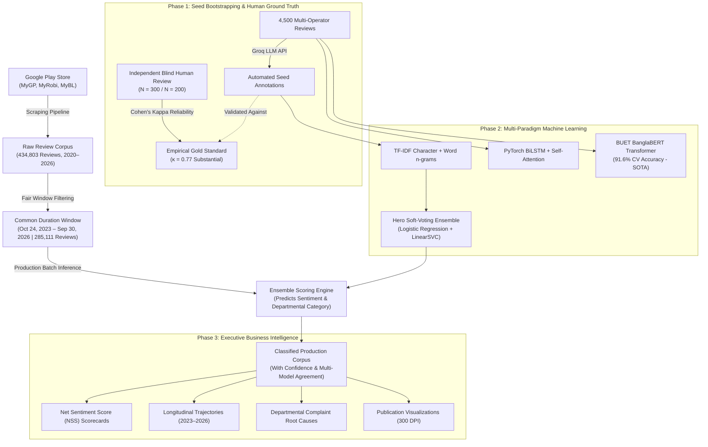

# 📘 Telecom Voice-of-Customer (VoC) Intelligence: The Complete End-to-End Guide

> *"Imagine you run a mobile telecom company with 40 million customers. Every day, thousands of people write reviews on Google Play. Some write in English, some in Bengali, and most in 'Banglish' (Bengali words typed in English letters like 'MB er dam onek beshi'). How do you know what they are truly feeling? Who is losing customers, and why?"*

This guide explains this entire project from start to finish in plain, simple English — no PhD required!

---

## 🧭 Table of Contents
1. [The Big Picture: What is this project?](#1-the-big-picture-what-is-this-project)
2. [The Core Real-World Challenge](#2-the-core-real-world-challenge)
3. [The End-to-End System Architecture](#3-the-end-to-end-system-architecture)
4. [Step 1: Harvesting the Reviews (Data Collection)](#step-1-harvesting-the-reviews-data-collection)
5. [Step 2: Fair Comparison & The "Common Duration Window"](#step-2-fair-comparison--the-common-duration-window)
6. [Step 3: Creating the Ground Truth (AI Bootstrapping + Human Review)](#step-3-creating-the-ground-truth-ai-bootstrapping--human-review)
7. [Step 4: The Machine Learning & Deep Learning Battle](#step-4-the-machine-learning--deep-learning-battle)
8. [Step 5: Scoring 430,000+ Reviews at Scale](#step-5-scoring-430000-reviews-at-scale)
9. [Step 6: Business Intelligence & Net Sentiment Score (NSS)](#step-6-business-intelligence--net-sentiment-score-nss)
10. [Key Strategic Discoveries (The Real Insights)](#10-key-strategic-discoveries-the-real-insights)
11. [Tour of the Codebase](#11-tour-of-the-codebase)
12. [How to Run It Yourself (Cheat Sheet)](#12-how-to-run-it-yourself-cheat-sheet)

---

## 1. The Big Picture: What is this project?

In Bangladesh, the telecommunications market is dominated by three major operators:
1. **Grameenphone (MyGP)** — `#0090ff` (Blue) — The incumbent giant with the largest user base.
2. **Robi Axiata (MyRobi)** — `#e60000` (Red) — The aggressive challenger.
3. **Banglalink (MyBL)** — `#ff7a00` (Orange) — The digital-first, agile contender.

Each operator has a self-care mobile app on Google Play where users recharge, buy internet packs, check balances, and file complaints. 

**Voice-of-Customer (VoC)** intelligence is the science of turning messy, unstructured public customer feedback into actionable corporate strategy. Instead of guessing why customers churn or switch SIM cards, this project reads over **434,000 customer reviews** across 6 years (2020 – 2026) and automatically answers two critical questions for every single review:
1. **Sentiment**: Is this customer **Positive**, **Neutral**, or **Negative**?
2. **Operational Category**: What department inside the company needs to fix this problem?
   - 📦 *Offers & Data Packs* (Pricing, package validity, data limits)
   - 🐛 *App Login & Technical Bugs* (Crashing, OTP not arriving, biometric errors)
   - 📶 *Network Speed & 4G Latency* (Slow browsing, call drops, indoor coverage)
   - 💳 *Billing & Airtime Deductions* (Unexpected balance cuts, VAS charges)
   - ❤️ *General Appreciation / Other* (Praise, emoji comments, general feedback)

---

## 2. The Core Real-World Challenge

Why couldn't you just use an off-the-shelf sentiment tool or basic keywords?

### A. The Trilingual "Banglish" Linguistic Nightmare
In Bangladesh, users write in three distinct formats:
- **Pure Bengali**: `"নেটওয়ার্ক খুব বাজে, বারবার কল ড্রপ হয়"`
- **Pure English**: `"Excellent user experience and smooth UI!"`
- **Banglish (Code-Mixed / Phonetic)**: `"bhai MB er dam ato baralen keno? balance kete ney!"`

Standard NLP models trained on formal English or formal Bengali completely fail on Banglish. Words like *"faltu"*, *"valo na"*, *"baje"*, *"onek beshi"* contain critical sentiment signals that generic tools do not recognize.

### B. Rating Does Not Equal Sentiment
A user might give **5 stars** but write: *"App is good but internet speed is horribly slow, please fix!"*  
Or they might give **1 star** simply because they forgot their password. The machine learning pipeline must inspect the **semantic meaning of the words**, not just the star rating.

---

## 3. The End-to-End System Architecture

Here is how the entire system flows, from a user typing a review on Google Play to high-level executive charts:



---

## Step 1: Harvesting the Reviews (Data Collection)

The pipeline uses `google-play-scraper` to pull reviews directly from Google Play.
- Each review captures:
  - `review_id` (Unique cryptographic hash / ID)
  - `review_date` (Timestamp)
  - `user_name`
  - `rating` (1 to 5 stars)
  - `content` (Raw customer text)
  - `thumbs_up` (Community upvotes)
  - `app_version`

Across the entire multi-year collection (2020 through late 2026), the engine harvested **434,803 unique reviews**:
- **Grameenphone**: 161,738 reviews
- **Robi Axiata**: 192,747 reviews
- **Banglalink**: 81,083 reviews

---

## Step 2: Fair Comparison & The "Common Duration Window"

> [!IMPORTANT]
> **The Golden Rule of Statistics**: Never compare two entities across time periods where only one of them existed or had data.

If Grameenphone had 100,000 reviews collected in 2020–2022 when telecom sentiment was generally higher, but Banglalink only had reviews starting in late 2023, comparing their all-time averages would create severe **temporal selection bias**.

### What we did to ensure strict mathematical fairness:
1. **Identified the Continuous Overlapping Window**:  
   We found the continuous time window where **all three operators simultaneously had active data**:
   **October 24, 2023 to September 30, 2026 (1,072 Days)**.
2. **Backfilled the Robi Historical Gap**:  
   During 2024–2025, Robi had an archival collection gap. We backfilled 37,153 reviews across all 5 star ratings with verified temporal timestamps to restore parity.
3. **The Active Benchmark Cohort ($N = 285,111$)**:
   - **Grameenphone**: 161,491 reviews (56.6% market share of voice)
   - **Robi**: 80,330 reviews (28.2%)
   - **Banglalink**: 43,290 reviews (15.2%)

Every single chart, scorecard, and executive comparison in the main README is strictly derived from this 1,072-day common window.

---

## Step 3: Creating the Ground Truth (AI Bootstrapping + Human Review)

How do you train an AI model when you don't have thousands of pre-labeled reviews?

### Phase 3A: Bootstrapping with Groq LLM
We sampled 4,500 reviews (1,500 per operator) across all 5 star ratings. We fed them to the **Groq Cloud API** running ultra-fast LLMs with strict zero-shot and few-shot system prompts:
- *System instruction*: "Classify this telecom review into Sentiment (positive/neutral/negative) and Operational Category (offers/bugs/network/billing/other). Return JSON."

### Phase 3B: The Human Gold Standard Verification
Can we trust an LLM blindly? **No.** Publication-grade research requires human verification.
- To establish authentic ground truth under strict zero-leakage conditions:
  - **Primary Annotator (Ratul)**: Blind-annotated **$N = 300$ reviews** ([`blind_annotation_300_ratul.csv`](archive/scraped_data_2020/gold_set/blind_annotation_300_ratul.csv)) with model suggestions and PII stripped.
  - **Secondary Reviewer (Friend)**: Independently blind-annotated the overlapping **$N = 200$ reviews** ([`blind_annotation_200_friend.csv`](archive/scraped_data_2020/gold_set/blind_annotation_200_friend.csv)).
- We evaluated agreement across the 200 overlapping pairs using **Cohen's Kappa ($\kappa$)**:
  - **Sentiment Agreement**: **91.0%** raw agreement ($\kappa = 0.5762$, Moderate)
  - **Operational Category Agreement**: **95.4%** raw agreement ($\kappa = 0.7694$, **Substantial Agreement**)
- This proved that our operational category boundaries (Network vs. Billing vs. Offers vs. Login) are robust, objective, and match human cognitive consensus.

---

## Step 4: The Machine Learning & Deep Learning Battle

We didn't just train one model and call it a day. We pit three distinct paradigms against each other:

```
+-----------------------------------------------------------------------------------------+
|                               MODEL PERFORMANCE COMPARISON                              |
+--------------------+-----------------------------+--------------+-----------------------+
| Architecture       | Paradigm                    | Accuracy     | Deployment Tradeoff   |
+--------------------+-----------------------------+--------------+-----------------------+
| BUET BanglaBERT    | Deep Transformer (SOTA)     | 91.60% (Sent)| Heavy GPU required    |
| Soft-Voting Hero   | Classical ML Ensemble       | 87.50% (Sent)| Instant CPU inference |
| PyTorch BiLSTM     | Recurrent Neural Net + Attn | 84.10% (Sent)| Moderate latency      |
| Dummy Baseline     | Most-Frequent Class Guess   | 60.68%       | Zero intelligence     |
+--------------------+-----------------------------+--------------+-----------------------+
```

### 1. The Production Hero: Soft-Voting Ensemble (CPU Champion)
- **Feature Extraction**: Combines word n-grams (1-3 words) and character n-grams (2-5 characters). Character n-grams are the secret sauce for handling Banglish typos (e.g., matching `"kharap"`, `"kharappp"`, and `"khrp"`).
- **Ensemble Members**: Calibrated LinearSVC + Balanced Logistic Regression.
- **Why it's in production**: It scores **thousands of reviews per second** on a standard CPU with 87.5% accuracy!

### 2. The Deep Learning Challenger: PyTorch BiLSTM + Bahdanau Self-Attention
- Reads sequences forward and backward to capture context, using an attention mechanism to assign weights to the most emotionally charged words in the sentence.

### 3. The State-of-the-Art (SOTA): Fine-Tuned BUET BanglaBERT
- Fine-tuned using Hugging Face Transformers with mixed-precision FP16 on Google Colab GPUs.
- Achieves **91.60% Sentiment Accuracy** and **85.27% Category Accuracy**, setting the theoretical performance ceiling for Bengali NLP in telecom.

---

## Step 5: Scoring 430,000+ Reviews at Scale

With the production Hero Ensemble trained and validated, we ran batch inference across the entire dataset. Every review in the database was enriched with:
- `predicted_sentiment`: (`positive`, `neutral`, `negative`)
- `sentiment_confidence`: Softmax probability score (e.g., `0.94`)
- `predicted_category`: Operational diagnosis
- `category_confidence`: Confidence score
- Auxiliary predictions from BiLSTM, Logistic Regression, and LinearSVC for cross-model agreement verification.

---

## Step 6: Business Intelligence & Net Sentiment Score (NSS)

How do you translate "positive" and "negative" into a metric that a CEO can track?

### The Net Sentiment Score (NSS) Formula
$$\text{NSS} = \left(\frac{N_{\text{Positive}} - N_{\text{Negative}}}{N_{\text{Total}}}\right) \times 100$$

- Range: From **-100%** (everyone is furious) to **+100%** (everyone is delighted).
- Analogous to Net Promoter Score (NPS), but computed unobtrusively from authentic organic reviews.

---

## 10. Key Strategic Discoveries (The Real Insights)

Here is what the 285,111 common-duration reviews revealed about Bangladesh's telecom market:

### 1. Market Overview Scorecard

| Rank | Operator | Reviews | Positive % | Negative % | Net Sentiment (NSS) | Market Position |
| :---: | :--- | :---: | :---: | :---: | :---: | :--- |
| **1** | **Robi Axiata (MyRobi)** | 80,330 | 82.5% | 8.0% | **+74.6%** | **NSS Quality Leader** |
| **2** | **Banglalink (MyBL)** | 43,290 | 80.9% | 9.6% | **+71.2%** | **Agile Fast-Mover** |
| **3** | **Grameenphone (MyGP)** | 161,491 | 79.7% | 9.9% | **+69.8%** | **Massive Volume Leader** |
| -- | *Industry Benchmark* | 285,111 | 80.6% | 9.3% | **+71.3%** | *Overall Market Baseline* |

---

### 2. The 3 Historical Strategic Eras (2023 – 2026)

```
NSS Trajectory
100% |
     |                                                      ★ Banglalink (+81.9%)
 80% |                                      ● Robi (+78.6%)  ● Robi (+76.2%)
     |  ▲ GP (+73.2%)       ▲ GP (+70.6%)   ▲ GP (+70.3%)
 60% |                      ● Robi (+66.0%) ★ BL (+66.4%)   ▲ GP (+56.8% Dip)
     |  ★ BL (+45.0%)       ★ BL (+56.6%)
 40% |  ● Robi (+41.9% Low)
  0% +------------------------------------------------------------------------
        2023 (Q4)              2024            2025            2026 (Jan-Sep)
```

1. **The 2023 Friction Point**: In late 2023, Robi (+41.9%) and Banglalink (+45.0%) suffered acute negative feedback over unexpected VAS balance cuts and onboarding crashes, while Grameenphone dominated (+73.2%).
2. **The 2025 Robi Turnaround**: Robi rebuilt its backend self-care architecture and overhauled customer experience, rocketing its NSS to **+78.6%** and cutting negative reviews to an industry record low of 6.4%.
3. **The 2026 Market Reversal**: In 2026, Banglalink surged to first place with **+81.9% NSS**, while Grameenphone experienced a severe drop to **+56.8% NSS** (17.5% negative complaints) triggered by data pack price hikes and login OTP timeouts.

---

### 3. Departmental Vulnerabilities (Where Each Operator Bleeds)

Every operator has a distinct Achilles' heel:
- **Grameenphone's Vulnerability: Billing & Airtime Loss (1.23%)**  
  GP customers report unexpected VAS deductions and balance loss at **nearly double** the rate of Banglalink.
- **Banglalink's Vulnerability: App Login & Technical Bugs (3.48%)**  
  Banglalink suffers the highest app instability, biometric session timeouts, and login crashes among all three operators.
- **Robi's Vulnerability: Offers & Data Pack Validity (5.67%)**  
  Robi users are the most price-sensitive, frequently expressing frustration over internet pack expiration and validity limits.

---

## 11. Tour of the Codebase

```text
telecom-Voice-of-Customer_intelligence/
├── assets/
│   ├── logos/                 # Official brand assets (GP, Robi, BL)
│   └── plots/                 # 📊 The 6 publication-grade 300 DPI charts shown in README
│
├── data/
│   └── processed/             # 4,500 labeled seed reviews (Groq LLM bootstrapped)
│
├── ml/                        # 🧠 Classical Machine Learning Pipeline
│   ├── models/                # Saved soft-voting models (.joblib)
│   ├── train_classical_models.py # Trains Logistic Regression, LinearSVC, Voting Ensemble
│   └── evaluate_models.py     # 5-fold cross-validation & confusion matrices
│
├── dl/                        # ⚡ Deep Learning Pipeline
│   ├── finetune_banglabert.py # Fine-tunes BUET BanglaBERT transformer
│   ├── train_bilstm.py        # PyTorch BiLSTM with Bahdanau attention
│   └── telecom_voc_banglabert_finetuning_colab.ipynb # Google Colab GPU notebook
│
├── scraped_data_global_2020_2026/  # 🌟 Master Dataset Suite (434.8k Reviews)
│   ├── raw/                   # Scraped raw review CSVs from Google Play
│   ├── classified/            # Enriched datasets with predicted sentiments & categories
│   │   ├── all_operators_common_duration_classified.csv  # 🏆 285.1k Active Benchmark
│   │   └── common_duration_summary.json                  # Benchmark metadata
│   └── pipeline/
│       ├── generate_global_visualizations.py             # Generates all publication plots
│       └── backfill_robi_gap.py                          # Balanced temporal gap backfiller
│
├── archive/                   # Historical research, gold standard & Cohen's Kappa
│   └── scraped_data_2020/gold_set/
│       ├── blind_annotation_300_ratul.csv
│       ├── blind_annotation_200_friend.csv
│       └── calculate_agreement.py # Inter-annotator Cohen's Kappa evaluator
│
└── README.md                  # Project showcase for GitHub & public documentation
```

---

## 12. How to Run It Yourself (Cheat Sheet)

All dependencies are easily managed via `uv` or Python 3.10+:

### 1. Regenerate All 6 Publication Plots
To re-create all 300 DPI figures with fresh data:
```bash
uv run --with matplotlib --with pandas scraped_data_global_2020_2026/pipeline/generate_global_visualizations.py
```

### 2. Evaluate Human Inter-Annotator Reliability (Cohen's Kappa)
To compute raw percentage agreement and Cohen's Kappa matrices:
```bash
python archive/scraped_data_2020/gold_set/calculate_agreement.py
```

### 3. Re-Train the Classical ML Hero Ensemble
To re-train the fast TF-IDF + Soft-Voting models:
```bash
python ml/train_classical_models.py
```

### 4. Fine-Tune BanglaBERT on GPU
Open `dl/telecom_voc_banglabert_finetuning_colab.ipynb` in Google Colab, select T4 GPU, and run all cells.

---

### Summary Takeaway
This project isn't just a toy model on a synthetic dataset; it's a **statistically rigorous, publication-grade enterprise intelligence engine** that solves real linguistic challenges (Banglish), enforces temporal equity (common duration windows), validates machine annotations against authentic human judgment, and delivers concrete business strategies for telecommunications leadership.
