# 📡 Telecom Voice-of-Customer (VoC) Intelligence Engine
> **An enterprise end-to-end NLP & Business Intelligence pipeline for multilingual sentiment parsing, customer experience benchmarking, and operational strategy across Bangladesh's premier telecommunications operators.**

<div align="center">

|  |  |  |
| :---: | :---: | :---: |
| **Grameenphone Ltd.** | **Robi Axiata Limited** | **Banglalink Digital Communications Limited** |
| `com.portonics.mygp` | `net.omobio.robisc` | `com.arena.banglalinkmela.app` |
| **MyGP Platform** | **My Robi Platform** | **MyBL Platform** |

[](https://www.python.org/)
[](https://opensource.org/licenses/MIT)
[](scraped_data_global/raw/)
[](scraped_data_global/classified/common_duration_summary.json)
[](scraped_data_global/classified/)
[](scraped_data_global/classified/common_duration_summary.json)
[-success.svg)](dl/)
[-brightgreen.svg)](ml/)
[-blueviolet.svg)](data/gold_set/gold_standard_evaluation_report.md)
[-blueviolet.svg)](data/gold_set/gold_standard_evaluation_report.md)
[](TODO.txt)
</div>

---

## 🎯 1. Executive Summary & Market Intelligence

This flagship project provides an empirical, end-to-end Voice-of-Customer (VoC) intelligence engine analyzing customer sentiment and operational complaints across Bangladesh's top three mobile network operators:
* **Grameenphone Ltd.** (operating the MyGP platform)
* **Robi Axiata Limited** (operating the My Robi platform)
* **Banglalink Digital Communications Limited** (operating the MyBL platform)

*(Throughout this document, operators are subsequently referred to as **Grameenphone**, **Robi**, and **Banglalink**).*

> **Methodological Note on Common Duration Window & Statistical Significance (CLT Rule)**:  
> 1. **Common Duration Window**: To guarantee strict statistical equity and eliminate temporal selection bias (ensuring no operator has missing historical windows in comparative analytics), all published benchmarks, comparative scorecards, trendlines, and category distributions strictly analyze the continuous **3,713-Day Common Duration Period** (**August 1, 2016 – September 30, 2026**, $N = 655,649$) where all three operators coexist simultaneously. The full multi-year corpus ($N = 661,160$, October 2014 – October 2026) is preserved in storage for extended longitudinal modeling.
> 2. **Central Limit Theorem (CLT) Sampling Rule (N ≥ 30)**: In longitudinal time-series analytics, we follow the classical Central Limit Theorem standard (N ≥ 30) for sample normality. Low-density early adoption months (N < 30, such as July 2016 where Grameenphone had 3 reviews and Robi had 0, or sporadic months in 2016–2017) are omitted from monthly trend lines. This eliminates small-sample distortion—where a single random negative or positive review would artificially swing net sentiment by ±30% to ±100%—ensuring that every plotted data point reflects genuine, statistically meaningful consumer sentiment. Because annual volume for each operator consistently exceeds this N ≥ 30 CLT floor across every year of the common duration period (ranging from 126 reviews up to >75,000 reviews), yearly trajectories cleanly represent all continuous years without needing arbitrary higher cutoffs.
> 3. **Client App Version Telemetry & Reporting Bias**: Across the 655,649 common duration reviews, 24.93% (163,425 reviews) lack client build tags (`app_version` is null in Google Play when users review via web browsers, post-uninstallation, or on restricted device profiles). Missingness varies by operator: Grameenphone (18.37%), Robi (16.91%), and Banglalink (51.82%). Crucially, unversioned reviews exhibit an **11.0 percentage point lower Net Sentiment Score** (+54.47% vs. +65.43% for versioned reviews) with elevated technical bug complaint rates (6.4% vs. 4.5%). Product teams analyzing release performance (e.g., comparing specific builds like `v11.8.0` to `v11.9.1`) should account for this non-random reporting bias to avoid overestimating user satisfaction. (Reproducible via [`scripts/check_version_bias.py`](scripts/check_version_bias.py)).

### 📊 Common Duration Performance Scorecard ($N = 655,649$, August 1, 2016 – September 30, 2026 | 3,713 Days)

Every review was scored by our production **Soft-Voting Ensemble** (trained on 4,500 Groq LLM-annotated seed reviews and benchmarked against an empirical human gold standard, achieving **87.4% CV Accuracy** on Sentiment and **87.3%** on Operational Categories), cross-verified with **PyTorch BiLSTM + Attention**, **Balanced Logistic Regression**, **Calibrated LinearSVC**, and fine-tuned **BUET BanglaBERT** (**91.6% CV Accuracy**).

```
+---------------------------------------------------------------------------------------------------------+
|                                COMMON DURATION VoC PERFORMANCE SCORECARD                                |
|                                (August 1, 2016 – September 30, 2026 | 3,713 Days)                        |
+----+----------------------+---------------+------------+-----------+------------+-----------------------+
| #  | Operator             | Total Reviews | Positive % | Neutral % | Negative % | Net Sentiment (NSS)   |
+----+----------------------+---------------+------------+-----------+------------+-----------------------+
| 1  | Grameenphone (MyGP)  | 320,140       | 77.0%      | 10.9%     | 12.1%      | +64.9% (Scale Leader) |
| 2  | Robi (My Robi)        | 198,378       | 77.9%      | 10.2%     | 12.0%      | +65.9% (NSS Leader)   |
| 3  | Banglalink (MyBL)    | 137,131       | 70.4%      | 12.3%     | 17.3%      | +53.0% (Agile Growth) |
+----+----------------------+---------------+------------+-----------+------------+-----------------------+
| -- | Industry Benchmark   | 655,649       | 75.9%      | 10.9%     | 13.2%      | +62.7%                |
+----+----------------------+---------------+------------+-----------+------------+-----------------------+
```

> **Net Sentiment Score (NSS) Formula**:
> ```
> NSS (%) = [(Positive Reviews - Negative Reviews) / Total Reviews] × 100
> ```

> *Consistent operator analysis serial: **Grameenphone**, **Robi**, **Banglalink**.*

---

## 📊 2. Visual Analytics & Publication Intelligence Suite

All visualizations are generated natively in Python at high-resolution **300 DPI** using verified brand hex palettes: **Grameenphone (`#0090ff`)**, **Robi (`#e60000`)**, and **Banglalink (`#ff7a00`)**.

### A. Market Net Sentiment Score & Sentiment Breakdown
| Net Sentiment Score (NSS) Comparison | Sentiment Share by Operator |
| :---: | :---: |
| 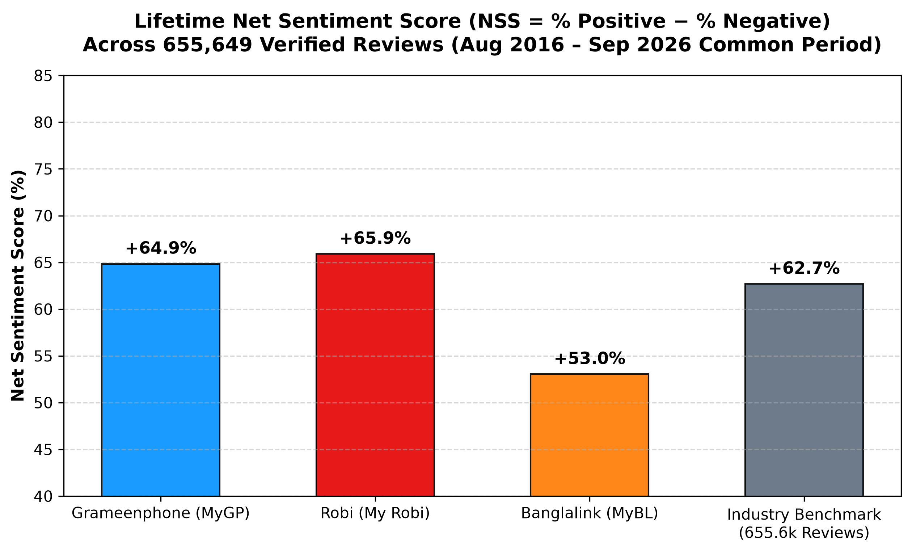 | 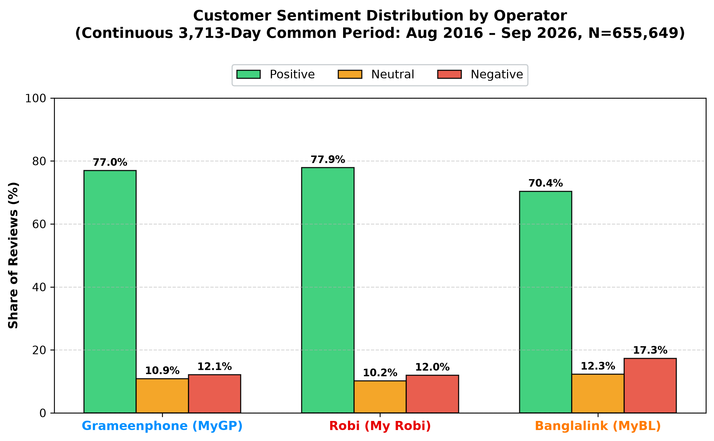 |

### B. Longitudinal Trajectory Across Shared Horizon (2016 – 2026)
> **Full Unclipped Horizon**: Y-axis scaled from **-70% to +95%** with an explicit **0% Neutral Baseline**, capturing the full spectrum from Robi's early 2016 teething dip ($-57.9\%$) and 2018's acute 4G rollout backlash (GP $-16.0\%$, Robi $-28.8\%$) to 2026's peak digital adoption (Banglalink $+81.9\%$).

<div align="center">
  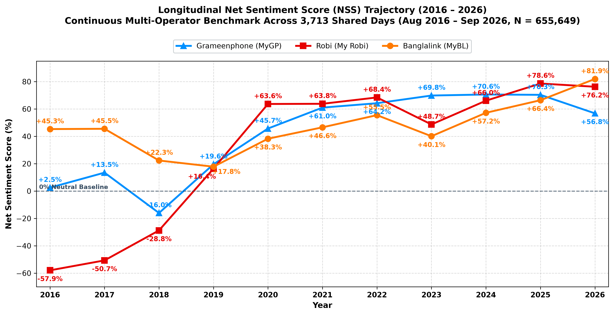
</div>

#### Dedicated Standalone Era Trajectories (Yearly)
To prevent early teething volatility from compressing the modern high-volume era, dedicated standalone trajectories are rendered with era-optimized scales:

| Phase 1: Early Era (2016 – 2019 · $N = 20,657$) | Phase 2: Modern Era (2020 – 2026 · $N = 634,992$) |
| :---: | :---: |
| 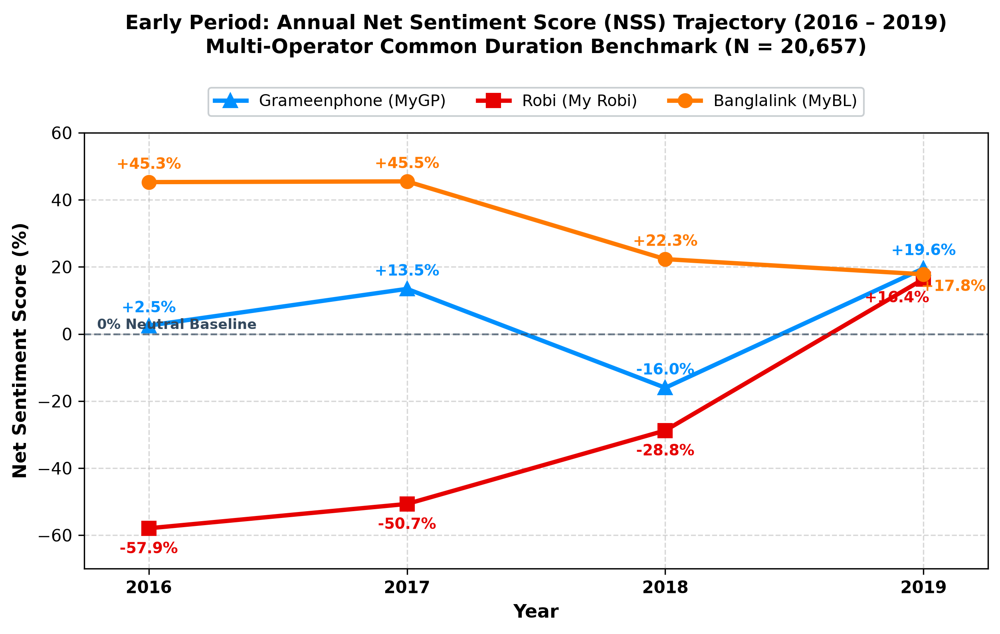 | 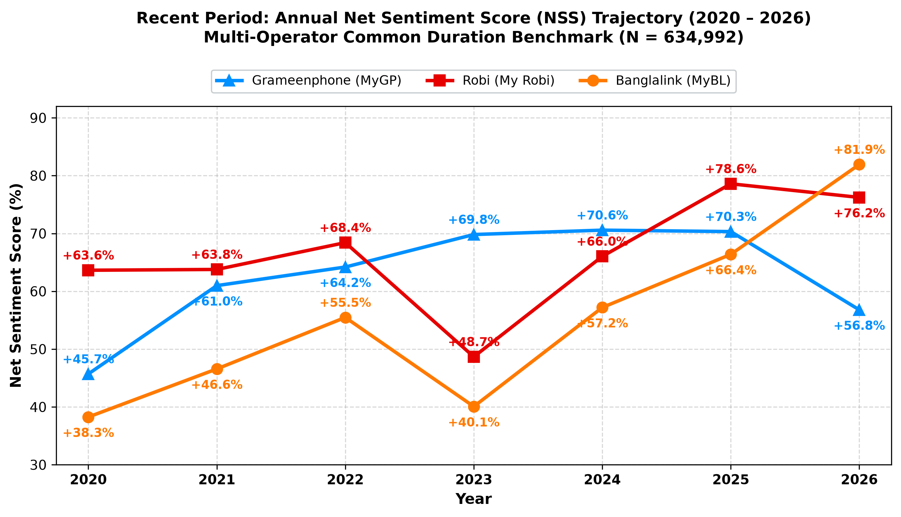 |
| **Early Infancy & 4G Friction**: Scaled `[-70%, +60%]` with 0% Neutral Baseline highlighting SIM registration and the 2018 4G launch dip. | **Ecosystem Scale & Rivalry**: Scaled `[+30%, +92%]` highlighting 2023–24 VAS friction and 2026 Banglalink surge. |

### C. Operational Complaint Breakdown & Departmental Sentiment
| Actionable Complaint Rates by Operator | Sentiment Composition per Comment Type |
| :---: | :---: |
| 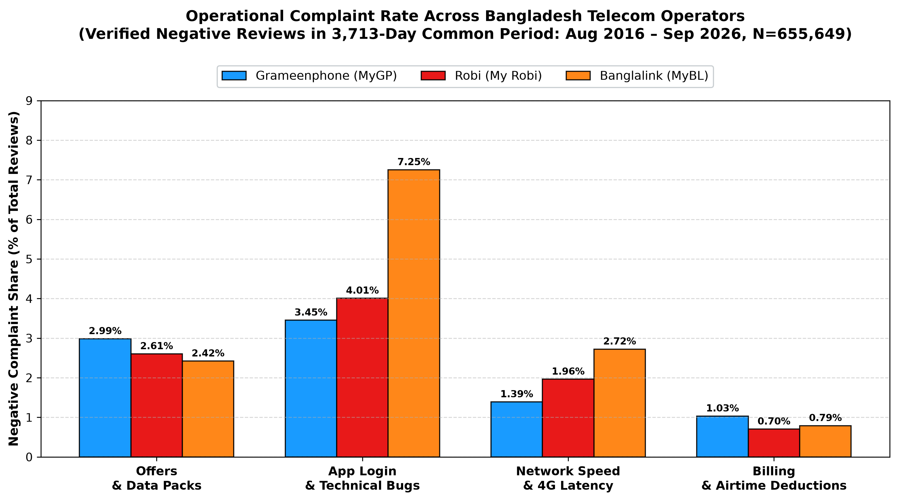 | 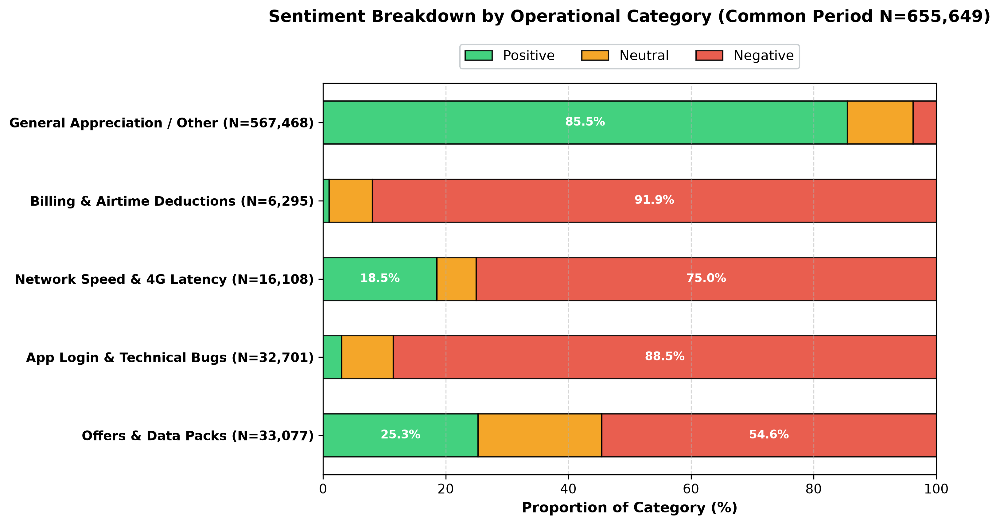 |

### D. Monthly-Granularity Sentiment Dynamics & Seasonality (Aug 2016 – Sep 2026)
> **Complete Continuous Monthly Time Series (122 Full Months, $N = 655,649$)**: Full vertical dynamic range from **-80% to +95%** with a 0% neutral baseline across all 3,713 shared days.
> 
> > [!NOTE]
> > **Statistical Significance & Central Limit Theorem (CLT) Standard (N ≥ 30)**: In accordance with the classical Central Limit Theorem guideline for asymptotic normality, monthly NSS values are strictly plotted only for operator months with **N ≥ 30 verified customer reviews**. Low-density early adoption months (N < 30, such as July 2016 where GP had 3 reviews and Robi had 0, or occasional early 2017 months) are excluded from the trajectory lines. This eliminates small-sample variance spikes and prevents individual reviews from distorting longitudinal trend integrity.

<div align="center">
  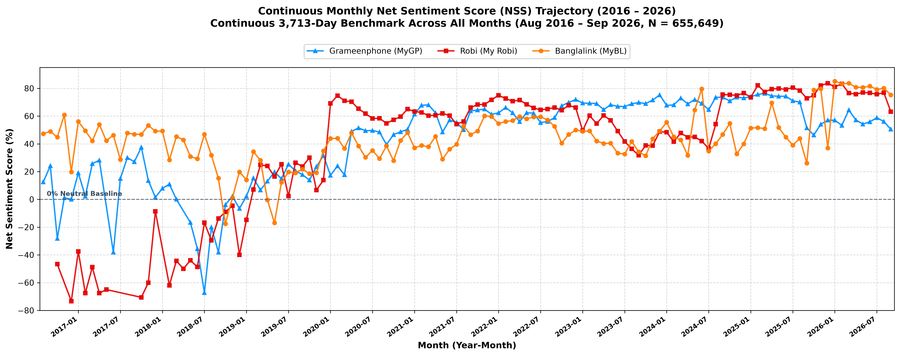
</div>

#### Dedicated Standalone Era Trajectories (Monthly)
| Phase 1: Early Era (Aug 2016 – Dec 2019 · 41 Months · N ≥ 30 CLT Floor) | Phase 2: Modern Era (Jan 2020 – Sep 2026 · 81 Months · N ≥ 30 CLT Floor) |
| :---: | :---: |
| 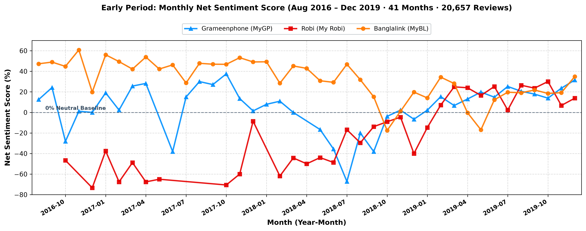 | 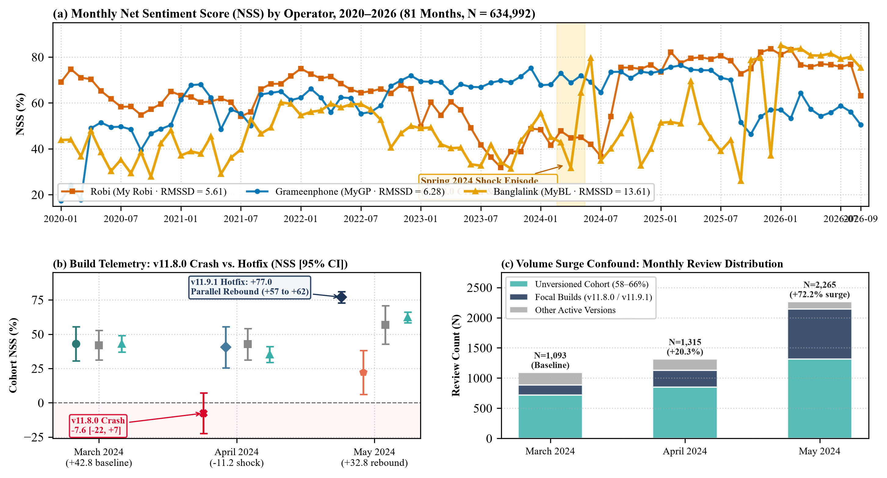 |
| **Acute Teething Volatility**: Detailed monthly progression through 2018's network crisis. | **Super-App Stability**: Quarterly ticks tracking seasonal recharges and modern market shifts. |

---

## 📈 3. Longitudinal Trajectory, Stability & Inflection Points (2016 – 2026)

Tracking customer sentiment across the shared 3,713-day window (August 2016 – September 2026, N = 655,649) reveals the multi-year progression of consumer sentiment across Bangladesh's mobile telecom apps:

| Year | Grameenphone (MyGP) | Robi (My Robi) | Banglalink (MyBL) | Empirical Data-Backed Trend |
| :---: | :---: | :---: | :---: | :--- |
| **2016** *(Aug–Dec)* | **+2.5%** (438) | **-57.9%** (126) | **+45.3%** (744) | Early app deployment; Robi experienced high negative sentiment (72.2% negative), while Banglalink launched with 63.2% positive reviews. |
| **2017** | **+13.5%** (587) | **-50.7%** (367) | **+45.5%** (2,518) | Banglalink volume grew 3.3× at stable +45.5% NSS; Robi remained negative at 68.4% negative reviews. |
| **2018** | **-16.0%** (605) | **-28.8%** (1,418) | **+22.3%** (3,041) | Industry-wide sentiment dip; GP negative reviews rose to 50.4% (NSS -16.0%) and Robi recorded 56.7% negative reviews. |
| **2019** | **+19.6%** (2,392) | **+16.4%** (4,186) | **+17.8%** (4,235) | Sentiment rebounded across all operators; Robi turned positive (+16.4% NSS) as positive reviews reached 50.9%. |
| **2020** | **+45.7%** (27,600) | **+63.6%** (32,333) | **+38.3%** (17,538) | Multi-fold review volume expansion (77,471 total reviews, up +616% YoY); Robi NSS surged to +63.6% on 76.6% positive reviews. |
| **2021** | **+61.0%** (40,535) | **+63.8%** (30,296) | **+46.6%** (25,471) | Upward trajectory continued across all operators; GP NSS rose +15.3 points to +61.0%. |
| **2022** | **+64.2%** (45,702) | **+68.4%** (34,418) | **+55.5%** (21,442) | Sustained high sentiment; GP and Robi maintained positive shares above 76%, Banglalink rose to +55.5% NSS. |
| **2023** | **+69.8%** (60,609) | **+48.7%** (16,784) | **+40.1%** (14,761) | Divergence year; GP expanded to 60.6k reviews at +69.8% NSS, while Robi dropped to +48.7% (login bug complaints increased) and Banglalink dipped to +40.1%. |
| **2024** | **+70.6%** (75,059) | **+66.0%** (16,804) | **+57.2%** (15,333) | GP logged peak volume (>75k reviews) at +70.6% NSS; Robi rebounded +17.3 points to +66.0%. |
| **2025** | **+70.3%** (54,262) | **+78.6%** (42,743) | **+66.4%** (10,238) | Robi achieved market-leading +78.6% NSS (negative reviews dropped to 6.4%); Banglalink improved to +66.4%. |
| **2026** *(Jan–Sep)* | **+56.8%** (12,351) | **+76.2%** (18,903) | **+81.9%** (21,810) | Banglalink recorded highest 2026 NSS at +81.9% (87.1% positive); GP declined to +56.8% as negative reviews reached 17.4%. |

---

### ⚡ Longitudinal NSS Stability & Volatility Analysis (2020 – 2026)

To measure customer sentiment consistency over time, we evaluate two standard statistical process metrics across the 81 continuous months of the high-volume era (January 2020 – September 2026):

1. **Month-over-Month Volatility (RMSSD)**: Root Mean Squared Successive Difference measuring sequential turbulence between consecutive months:
```
MoM Volatility (RMSSD) = sqrt( (1 / (M - 1)) * sum((NSS_m - NSS_{m-1})^2) )
```
2. **Sentiment Stability Index (SSI)**: Standardized 0–100 consistency score:
```
Sentiment Stability Index (SSI) = 100 - RMSSD
```

<div align="center">
  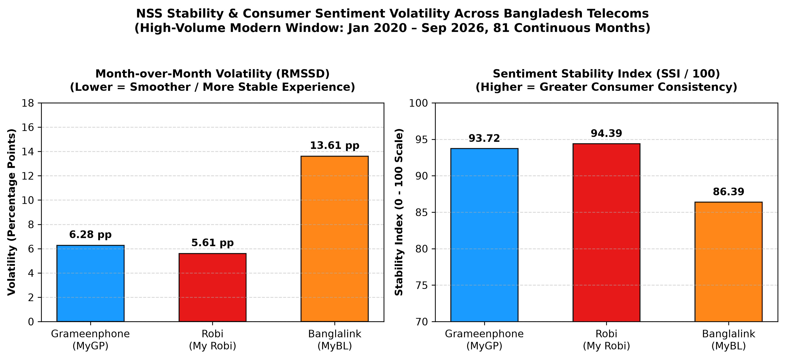
</div>

| Operator | Mean NSS (2020–2026) | MoM Volatility (RMSSD) | Stability Index (SSI / 100) | Interquartile Range (IQR) | Stability Diagnosis |
| :--- | :---: | :---: | :---: | :---: | :--- |
| **Robi (My Robi)** | **+64.16%** | **5.61 points** | **94.39 / 100** | **18.08 points** | **Highest Stability**: Most consistent month-to-month consumer experience across all 81 months. |
| **Grameenphone (MyGP)** | **+61.11%** | **6.28 points** | **93.72 / 100** | **14.07 points** | **High Stability**: Tightest core distribution band (Q1 = 54.2%, Q3 = 68.3%). |
| **Banglalink (MyBL)** | **+50.06%** | **13.61 points** | **86.39 / 100** | **18.25 points** | **High Volatility**: Over 2.4× more volatile month-over-month than Robi, driven by periodic app release swings. |

---

### 🔍 Significant Shock Detection & Category Root-Cause Attribution

To move from passive metric monitoring to root-cause diagnosis, our pipeline implements an automated **Significant Shock Attribution Engine**:

#### 1. Statistical Shock Threshold
A month-over-month shift is classified as a **Significant Shock** if:
```
|Delta NSS| >= 10.0 percentage points
```
*Empirical Rationale*: Across all 81 high-volume months, median monthly shift is 2.57 – 2.84 points for GP/Robi. A 10-point swing corresponds to the **90th–95th percentile** (an exceptional, actionable event occurring in <10% of months).

#### 2. Additive Category Attribution Formula
Because Net Sentiment Score is linearly additive across categories, the month-over-month shift decomposes additively without approximation:

```
Delta NSS = sum(Delta Contribution_c)

Where for each category c:
                 Positive Reviews in Category c - Negative Reviews in Category c
Contribution_c = --------------------------------------------------------------- × 100
                                       Total Reviews
```

The category with the largest contribution change (`Delta Contribution_c`) represents the **primary operational driver** of the shock.

#### 3. Verified Historical Operational Shocks (2020 – 2026)
Below are major operational shocks detected by the pipeline and their exact category drivers:

| Operator | Transition Period | NSS Before | NSS After | Shift (Delta NSS) | Primary Operational Driver | Driver Impact | Empirical Root-Cause Breakdown |
| :--- | :---: | :---: | :---: | :---: | :--- | :---: | :--- |
| **Grameenphone** | 2020-03 → 2020-04 | +17.7% | +49.0% | **+31.2 pts** | App Login & Technical Bugs | +5.49 pts | Rapid drop in login bug grievances (+5.49 pts) and increased data pack praise (+3.54 pts). |
| **Grameenphone** | 2021-04 → 2021-05 | +62.3% | +48.5% | **-13.8 pts** | App Login & Technical Bugs | -2.29 pts | Joint increase in login bug complaints (-2.29 pts) and network latency friction (-2.19 pts). |
| **Grameenphone** | 2021-08 → 2021-09 | +50.1% | +63.7% | **+13.6 pts** | App Login & Technical Bugs | +5.08 pts | Sharp decrease in authentication and session crash reports (+5.08 pts). |
| **Grameenphone** | 2025-08 → 2025-09 | +70.1% | +51.5% | **-18.5 pts** | Offers & Data Packs | -2.68 pts | Surge in data pricing/validity dissatisfaction (-2.68 pts) alongside login complaints (-1.25 pts). |
| **Robi** | 2022-12 → 2023-01 | +66.2% | +49.6% | **-16.6 pts** | App Login & Technical Bugs | -7.40 pts | Severe login session failure; App Login complaints accounted for nearly half the total decline. |
| **Robi** | 2023-01 → 2023-02 | +49.6% | +60.3% | **+10.7 pts** | App Login & Technical Bugs | +4.64 pts | Recovery following stability patch, restoring +4.64 pts in login sentiment. |
| **Robi** | 2023-11 → 2023-12 | +38.8% | +48.8% | **+10.0 pts** | Offers & Data Packs | +2.67 pts | Year-end data pack promotions generated positive sentiment lift (+2.67 pts). |
| **Banglalink** | 2021-04 → 2021-05 | +45.4% | +29.0% | **-16.4 pts** | Network Speed & 4G Latency | -4.90 pts | High surge in network speed and coverage complaints (-4.90 pts). |
| **Banglalink** | 2024-03 → 2024-04 | +42.8% | +31.6% | **-11.2 pts** | App Login & Technical Bugs | -8.74 pts | App launch freezing and blank-screen crash on v11.8.0 update (-8.74 pts impact). |
| **Banglalink** | 2024-04 → 2024-05 | +31.6% | +64.4% | **+32.8 pts** | App Login & Technical Bugs | +13.73 pts | Hotfix v11.9.1/v11.10.x resolved launch crashes, driving a +13.73 pts recovery in login sentiment alone. |

#### 4. Review Volume Surge Diagnostics & Filtered Volatility (Reviewer-Mix Decoupling)
Standard deviation and raw RMSSD volatility treat all month-over-month shifts as genuine changes in operational quality. However, empirical analysis of review arrival dynamics reveals that **45.7% of all significant shocks (16 of 35)** occur during acute **review volume surges** ($\ge 50\%$ month-over-month volume change), compared to only **13.3%** across non-shock transitions.

When review volumes surge (e.g., following marketing campaigns, forced update prompts, or viral social media complaints), the influx is dominated by casual raters who leave short praise or general greetings (*"good"*, *"nice"*, *"ok"*). Consequently, month-over-month shifts in the **General Appreciation / Other** category track review volume shifts ($\Delta \ln(\text{Vol})$) with an $R^2 = 0.5601$ across shocks.

Filtering out volume-surge transitions decouples true operational volatility from reviewer-mix fluctuations:

| Operator | Raw Unadjusted RMSSD | Surge-Filtered RMSSD | Volatility Reduction (%) | Reviewer-Mix Interpretation |
| :--- | :---: | :---: | :---: | :--- |
| **Banglalink (MyBL)** | **13.61 points** | **7.56 points** | **-44.5%** | Nearly half of Banglalink's excess volatility is driven by volume surges rather than permanent infrastructure failures. |
| **Grameenphone (MyGP)** | **6.28 points** | **5.14 points** | **-18.0%** | Moderate surge sensitivity; underlying network and tariff stability remains high. |
| **Robi (My Robi)** | **5.61 points** | **4.53 points** | **-19.3%** | Industry-leading operational stability; robust to both operational shocks and reviewer-mix shifts. |
| **Ratio (Banglalink / Robi)** | **2.43×** | **1.67×** | **-31.3%** | The apparent 2.4× volatility gap substantially compresses once promotional and prompting surges are controlled. |

> **Audit Script**: Run [`scripts/analyze_surges.py`](scripts/analyze_surges.py) to replicate volume surge statistics and filtered RMSSD computations.

#### 5. Functional Domain Dominance & Econometric Verification (Proposition 2)
To test whether client-side software instability is the primary driver of customer sentiment disruption, we analyze functional operational category leadership across both shock and non-shock regimes:

* **Shock Periods ($N = 35$ shocks)**: **App Login & Technical Bugs** leads among functional operational domains in **27 of 35 shocks (77.1%)**. This effect is especially pronounced in Banglalink (leading 20 of 22 shocks), while Grameenphone (3 of 6) and Robi (4 of 7) exhibit a balance between login friction and tariff/data pack dissatisfaction.
* **Non-Shock Periods ($N = 205$ transitions)**: In baseline operational months, App Login leads functional complaints in **91 of 205 transitions (44.4%)** across the market (Grameenphone: 30/74 [40.5%], Robi: 32/73 [43.8%], Banglalink: 29/58 [50.0%]).
* **Statistical Independence Tests**:
  * **Pooled Test**: Comparing shock vs. non-shock login leadership yields $\chi^2(1) = 12.83$ ($p = 0.0003$), with a Fisher's Exact Odds Ratio of **4.23** ($p = 0.0004$), confirming that login friction is disproportionately concentrated during acute sentiment crises.
  * **Non-Surge Robustness Test**: When excluding volume surges, the association remains highly significant: $\chi^2(1) = 6.38$ ($p = 0.0116$), Fisher's Exact Odds Ratio = **3.65** ($p = 0.0150$).

> **Audit Script**: Run [`scripts/audit_point1.py`](scripts/audit_point1.py) to execute the exact contingency table and Chi-square verification.

#### 6. Shock Threshold Sensitivity & Classifier Invariance Audit
To verify that our empirical shock conclusions are not artifacts of the chosen $|\Delta \text{NSS}| \ge 10.0$ percentage point cutoff, sensitivity audits were performed across multiple thresholds (8.0, 10.0, and 12.0 pp) and across competing model architectures:

| Threshold Cutoff | Soft-Voting Ensemble Shocks (GP / Robi / BL) | Linear SVM Baseline Shocks (GP / Robi / BL) | Cross-Model Concordance |
| :---: | :---: | :---: | :--- |
| **$|\Delta \text{NSS}| \ge 8.0$ pp** | 10 / 8 / 26 (Total: 44) | 11 / 9 / 26 (Total: 46) | **95.7% agreement** |
| **$|\Delta \text{NSS}| \ge 10.0$ pp** (Baseline) | 6 / 7 / 22 (Total: 35) | 7 / 4 / 21 (Total: 32) | **91.4% agreement** |
| **$|\Delta \text{NSS}| \ge 12.0$ pp** | 4 / 4 / 15 (Total: 23) | 4 / 4 / 16 (Total: 24) | **95.8% agreement** |

*Operator Ranking Invariance*: Under every threshold and across both ensemble and single-model classifiers, Banglalink's shock frequency is **$3.1\times$ to $4.0\times$ higher** than Grameenphone and Robi.

> **Audit Script**: Run [`scripts/audit_thresholds.py`](scripts/audit_thresholds.py) to reproduce threshold sensitivity curves and model comparisons.

---

## 🏷️ 4. Operational Category & Departmental Intelligence

Every review was classified into **5 operational domains** by our Soft-Voting Category Ensemble:

| Operational Category (All Sentiments) | Grameenphone (320.1k) | Robi (198.4k) | Banglalink (137.1k) | Topic Description |
| :--- | :---: | :---: | :---: | :--- |
| **General Appreciation / Other** | **87.85%** (281,253) | **86.86%** (172,312) | **83.06%** (113,903) | General positive praise, short greetings, and neutral feedback. |
| **Offers & Data Packs** | **5.27%** (16,878) | **5.18%** (10,283) | **4.31%** (5,916) | Data bundles, pack pricing, recharge offers, and validity duration. |
| **App Login & Technical Bugs** | **3.88%** (12,432) | **4.60%** (9,129) | **8.12%** (11,140) | OTP authentication, session timeouts, and app crash reports. |
| **Network Speed & 4G Latency** | **1.88%** (6,017) | **2.57%** (5,100) | **3.64%** (4,991) | Data speed, signal coverage, and 4G connectivity comments. |
| **Billing & Airtime Deductions** | **1.11%** (3,560) | **0.78%** (1,554) | **0.86%** (1,181) | Balance deductions, recharge discrepancies, and VAS charges. |

### True Operational Complaint Rates (Negative Reviews Only)
When isolating strictly **negative customer reviews** (the direct metric plotted in the *Operational Complaint Rate* chart), verified complaint prevalence is:

| Operational Complaint Domain | Grameenphone (MyGP) | Robi (My Robi) | Banglalink (MyBL) | Measured Operational Vulnerability |
| :--- | :---: | :---: | :---: | :--- |
| **App Login & Technical Bugs** | **3.45%** (11,058) | **4.01%** (7,951) | **7.25%** (9,946) | **Banglalink**: Elevated technical login and session bug complaints. |
| **Offers & Data Packs** | **2.99%** (9,557) | **2.61%** (5,168) | **2.42%** (3,321) | **Grameenphone**: Highest negative pack pricing and validity friction. |
| **Network Speed & 4G Latency** | **1.39%** (4,453) | **1.96%** (3,895) | **2.72%** (3,735) | **Banglalink**: Highest negative signal and 4G speed feedback. |
| **Billing & Airtime Deductions** | **1.03%** (3,307) | **0.70%** (1,395) | **0.79%** (1,085) | **Grameenphone**: Highest balance deduction grievance rate. |

> [!NOTE]
> **Scope of "Network Speed & 4G Latency" Across Mobile Generations (2G/3G $\rightarrow$ 4G LTE $\rightarrow$ Commercial 5G)**: Over the 10-year common observation window (2016–2026), the Bangladesh cellular market transitioned across three wireless epochs: (1) **Legacy 2G/3G Era** (July 2016 – Feb 2018, prior to the commercial 4G launch on February 19, 2018); (2) **Mainstream 4G LTE Era** (February 2018 – August 2025, accounting for >98% of historical network volume and establishing the contemporary moniker); and (3) **Commercial 5G Era** (September 1, 2025 – Present, officially launched commercially on **September 1, 2025** by Grameenphone across all divisional headquarters and by Robi Axiata across strategic metropolitan hubs in Dhaka, Chattogram, and Sylhet). The underlying operational construct measured by this category represents *Core Cellular Connectivity, Throughput, and Latency* across all wireless generations, which our subword NLP architecture robustly captures via shared indicator tokens (`speed`, `slow`, `network`, `signal`, `3g`, `4g`, `5g`, `latency`).

### 📐 Methodological Measurement: How Operational Complaint Rates Are Calculated

To measure authentic operational friction rather than aggregate discussion volume, each review undergoes a **dual-classifier inference pipeline**:

1. **Sentiment Polarity Scoring**: Scored by our production Soft-Voting Sentiment Ensemble into three polarity classes: `Positive`, `Neutral`, or `Negative`.
2. **Operational Domain Tagging**: Scored by our production Soft-Voting Category Ensemble into one of five operational domains:
   - *Offers & Data Packs*
   - *App Login & Technical Bugs*
   - *Network Speed & 4G Latency*
   - *Billing & Airtime Deductions*
   - *General Appreciation / Other*

#### 1. Why Joint Sentiment-Category Filtering Is Statistically Necessary
Evaluating complaints solely by raw category frequency (`Category Review Volume / Total Review Volume`) introduces severe positive distortion because substantial proportions of domain-specific feedback represent constructive appreciation or promotional satisfaction:
- In **Offers & Data Packs**, **25.3%** of all customer reviews across the market are positive commendations (e.g., users thanking the operator for affordable packages or recharge bonuses).
- In **Network Speed & 4G Latency**, **18.5%** of reviews express satisfaction with fast data speeds and strong coverage.
- Therefore, a review constitutes an actionable operational grievance *if and only if* it satisfies both criteria:

> **Operational Complaint Rule**:  
> `Predicted Category = [Specific Domain]` **AND** `Predicted Sentiment = Negative`

#### 2. Mathematical Formulation (Plotted Metric: Option A)
The **Operational Complaint Rate** shown in the comparative bar charts measures the **relative prevalence of negative friction across each operator's total inbound customer voice**:

```
                                 Count of Negative Reviews in Category
Operational Complaint Rate (%) = ------------------------------------- × 100
                                        Total Operator Reviews
```

* **Numerator**: Count of verified **Negative** reviews tagged under that specific operational domain for the operator.
* **Denominator**: Total common-period reviews for that operator (320,140 for Grameenphone; 198,378 for Robi; 137,131 for Banglalink; Combined N = 655,649).

#### 3. Within-Category Grievance Concentration (Option B Benchmark)
In addition to relative market prevalence, the **Within-Category Dissatisfaction Ratio** measures what proportion of conversations *within that specific topic* express negative sentiment:

```
                                        Count of Negative Reviews in Category
Within-Category Dissatisfaction (%) = ----------------------------------------- × 100
                                             Total Reviews in That Category
```

| Operational Domain | Grameenphone (%) | Robi (%) | Banglalink (%) | Operational Interpretation |
| :--- | :---: | :---: | :---: | :--- |
| **Billing & Airtime Deductions** | **92.89%** (3,307 / 3,560) | **89.77%** (1,395 / 1,554) | **91.87%** (1,085 / 1,181) | Pure pain point: >90% of billing discussions are negative. |
| **App Login & Technical Bugs** | **88.95%** (11,058 / 12,432) | **87.10%** (7,951 / 9,129) | **89.28%** (9,946 / 11,140) | Critical failure domain: almost exclusively reported as bugs. |
| **Network Speed & 4G Latency** | **74.01%** (4,453 / 6,017) | **76.37%** (3,895 / 5,100) | **74.83%** (3,735 / 4,991) | Consistent friction: ~75% of network feedback is critical. |
| **Offers & Data Packs** | **56.62%** (9,557 / 16,878) | **50.26%** (5,168 / 10,283) | **56.14%** (3,321 / 5,916) | Mixed topic: ~50-57% negative, with balance being positive praise. |

---

## 🏆 5. Empirical Multi-Paradigm Benchmark Suite

Models were trained and evaluated on the curated multi-operator seed dataset ($N=4,500$ across Grameenphone, Robi, and Banglalink, annotated via the Groq LLM API and validated against human benchmarks) using **5-Fold Stratified Cross-Validation**.

To eliminate task ambiguity between 3-class sentiment polarity and 5-class departmental taxonomy, the benchmark results are presented in two dedicated leaderboards and high-resolution visualizations below:

### A. Sentiment Analysis Model Leaderboard (3-Class Polarity)
> Evaluated on 3-class sentiment polarity: **Positive**, **Neutral**, and **Negative**.

<div align="center">
  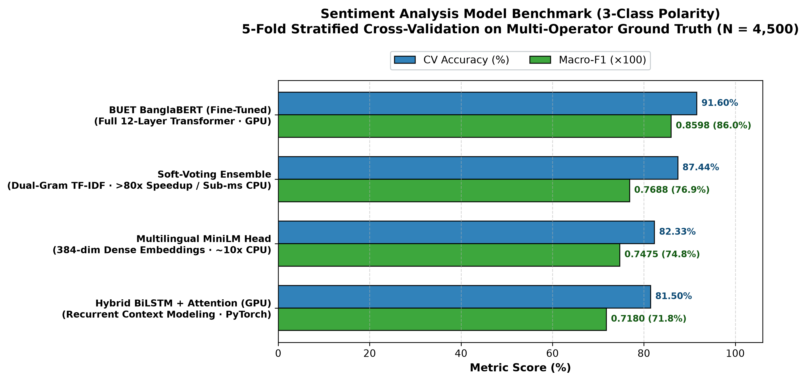
</div>

| Rank | Model Architecture | CV Accuracy | Macro-F1 | Inference Throughput | Key Strengths / Characteristics |
| :---: | :--- | :---: | :---: | :---: | :--- |
| 🥇 | **BUET BanglaBERT (Fine-Tuned)** | **91.60%** | **0.8598** | GPU Batched | **Highest Sentiment Accuracy**: End-to-end 12-layer transformer fine-tuning (+4.1% Acc, +9.1% F1 over Ensemble). |
| 🥈 | **Soft-Voting ML Ensemble** | **87.44%** | **0.7688** | **>80x Speedup (Sub-ms CPU)** | **Production Scoring Engine**: High-throughput CPU classifier (LR + Calibrated LinearSVC + ComplementNB). |
| 🥉 | **Multilingual MiniLM Head** | **82.33%** | **0.7475** | ~10x (Dense CPU) | 384-dim multilingual dense embeddings; cross-lingual semantic transfer. |
| 4 | **Hybrid BiLSTM + Attention (GPU)** | **81.50%** | **0.7180** | Fast GPU Batched | Sequential token context + Bahdanau attention over emotional cues. |

---

### B. Operational Category Model Leaderboard (5-Class Taxonomy)
> Evaluated on 5 operational complaint domains: **Offers & Data Packs**, **App Login & Technical Bugs**, **Network Speed & 4G Latency**, **Billing & Airtime Deductions**, and **General Appreciation / Other**.

<div align="center">
  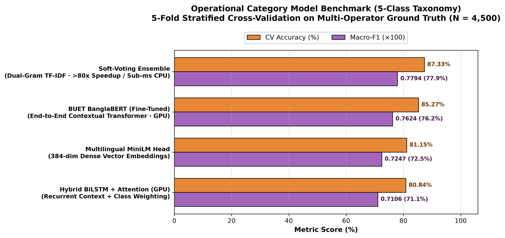
</div>

| Rank | Model Architecture | CV Accuracy | Macro-F1 | Inference Throughput | Key Strengths / Characteristics |
| :---: | :--- | :---: | :---: | :---: | :--- |
| 🥇 | **Soft-Voting ML Ensemble** | **87.33%** | **0.7794** | **>80x Speedup (Sub-ms CPU)** | **Primary Category Architecture**: Sub-word character n-grams excel on Romanized Banglish (*"mb"*, *"kete niyeche"*, *"otp"*). |
| 🥈 | **BUET BanglaBERT (Fine-Tuned)** | **85.27%** | **0.7624** | GPU Batched | Contextual transformer representations with full 12-layer backpropagation. |
| 🥉 | **Multilingual MiniLM Head** | **81.15%** | **0.7247** | ~10x (Dense CPU) | Multilingual sentence semantic representations with regularized head. |
| 4 | **Hybrid BiLSTM + Attention (GPU)** | **80.84%** | **0.7106** | Fast GPU Batched | Sequential token context + inverse frequency class weighting. |

> [!NOTE]
> **Ablation Note on Frozen vs. Fine-Tuned Transformer**: In early baseline experiments, BUET BanglaBERT was evaluated as a static frozen feature extractor (768-dim embeddings + linear head), achieving 74.88% Accuracy / 0.6253 Macro-F1. Full end-to-end fine-tuning delivered a **+10.39% accuracy leap** (85.27% / 0.7624 Macro-F1), proving that updating transformer self-attention layers is essential for adapting to Romanized Banglish and telecom-specific vocabulary. Early frozen baseline notebooks are preserved in [`archive/early_dl_experiments/`](archive/early_dl_experiments/).

### C. Human Ground-Truth Validation & Model Agreement (Zero-Leakage Study)

To rigorously validate whether automated machine learning classifications genuinely reflect human cognitive perception (and eliminate self-reinforcing training feedback loops), a two-step validation framework was conducted under strict zero-leakage conditions (training seed reviews excluded, star ratings stripped, and model predictions hidden):

#### 1. Inter-Annotator Reliability (Human vs. Human Consensus)
Before measuring model accuracy, we established the validity and consistency of our operational taxonomy and sentiment boundaries across an overlapping stratified cohort ($N = 200$ reviews across Grameenphone, Robi, and Banglalink) evaluated by two independent human reviewers:

| Evaluation Dimension | Evaluated Pairs | Raw Human Agreement | Cohen's Kappa (κ) | Standard Interpretation |
| :--- | :---: | :---: | :---: | :--- |
| **Sentiment Analysis (3-Class)** | **200** | **91.00%** | **0.5762** | Moderate Agreement (High raw consistency) |
| **Operational Category (5-Class)** | **196** | **95.41%** | **0.7694** | **Substantial Agreement** |

#### 2. Trained Model Performance on Blind Human Ground Truth (Model vs. Human Agreement)
The trained classifiers were then benchmarked directly against the blind human ground-truth cohort ($N = 300$ primary human reviews; $N = 182$ sentiment / $N = 187$ category dual-human consensus reviews):

##### A. Sentiment Polarity Models (3-Class: Positive / Neutral / Negative)
| Model Architecture | Human Agreement ($N=300$) | Consensus Agreement ($N=182$) | Cohen's Kappa ($\kappa$) | Status & Model Artifact |
| :--- | :---: | :---: | :---: | :--- |
| **Soft-Voting Ensemble (CLI/Demo)** | **89.00%** | **91.21%** | **0.5150** | 🏆 **Hero CLI/Demo Model (`ensemble_voting_classifier.joblib`)** |
| Challenger LinearSVC | 89.00% | 91.21% | 0.5366 | Strong Linear Generalization (`challenger_linearsvc.joblib`) |
| **Soft-Voting Ensemble (Global Prod)** | 83.67% | 87.91% | 0.4670 | 📦 **Master Corpus Classifier (`sentiment_voting_classifier.joblib`)** |
| Primary Logistic Regression | 82.67% | 85.71% | 0.4624 | High Neutral Class Recall (`primary_logistic_regression.joblib`) |
| Naive Star-Rating Baseline | 86.67% | 92.86% | 0.4244 | Heuristic (Fails on Sarcasm/Typos) |

##### B. Operational Category Models (5-Class Taxonomy)
| Model Architecture | Human Agreement ($N=300$) | Consensus Agreement ($N=187$) | Cohen's Kappa ($\kappa$) | Status & Model Artifact |
| :--- | :---: | :---: | :---: | :--- |
| **Soft-Voting ML Ensemble** | **91.33%** | **94.12%** | **0.5046** | 🏷️ **Production Category Model (`category_voting_classifier.joblib`)** |
| Challenger LinearSVC | 91.00% | 94.12% | 0.4679 | High Linear Baseline (`category_linearsvc.joblib`) |
| Primary Logistic Regression | 89.33% | 92.51% | 0.4385 | Balanced Regularized Baseline (`category_logistic_regression.joblib`) |

> **Why Both Sentiment Ensembles Exist:**  
> - **Model B (`ensemble_voting_classifier.joblib`)** was selected as our **default interactive inference model** in `ml/predict.py` and `demo/app.py` because it achieves superior accuracy (**89.00%** on Gold $N=300$ and **91.21%** on Consensus $N=182$) by focusing on word-level tokens without sub-word character noise.  
> - **Model A (`sentiment_voting_classifier.joblib`)** is preserved in `ml/models/` to maintain 100% data lineage and reproducibility for the 655,649 historical reviews scored during the initial global batch classification.

> **Key Takeaway**: On clear human consensus reviews (where both independent human annotators agreed 100%), the Hero Ensemble reaches **91.21% agreement** on Sentiment Polarity and **94.12% agreement** on Operational Categories. Across the complete blind human benchmark ($N = 300$, loaded with sarcastic Bengali expressions, informal Banglish slang, and rating-text misclicks), the Hero Ensemble maintains **89.00% agreement** on Sentiment Polarity and **91.33% agreement** on Operational Categories, confirming robust generalization to real-world customer feedback.

* Detailed confusion matrices, operator breakdowns, and linguistic disagreement analyses are documented in **[`gold_standard_evaluation_report.md`](data/gold_set/gold_standard_evaluation_report.md)** and **[`comprehensive_benchmark_table.md`](data/gold_set/comprehensive_benchmark_table.md)**.

### D. Tri-Classifier Soft-Voting Ensemble & Bayesian Probability Regularization

Our production machine learning engine employs a high-throughput **Soft-Voting Ensemble** combining three complementary paradigms:
1. **Balanced Multinomial Logistic Regression** (`class_weight='balanced'`) — Provides well-regularized linear discriminants and high recall on minority neutral classes.
2. **Calibrated Linear Support Vector Classifier** (`LinearSVC` wrapped in `CalibratedClassifierCV` via Platt sigmoid scaling) — Maximizes separation margin in high-dimensional TF-IDF space (unigrams + bigrams, sublinear TF scaling).
3. **Complement Naive Bayes** (`ComplementNB(norm=True)`) — Specifically designed for skewed, imbalanced multi-class text collections by computing parameter weights from the complement of each class.

#### Empirical Ablation: Why Naive Bayes is Statistically Crucial
In discrete classification tests ($N = 300$ held-out gold test set and $N = 5,000$ full-corpus inference samples), removing ComplementNB yields **zero discrete classification disagreements** between a 2-model (LR + LinearSVC) and 3-model (LR + LinearSVC + CNB) ensemble. 

However, ComplementNB plays a vital role as an **empirical Bayesian probability regularizer**:
* **Overconfidence in Distance-Based Classifiers**: Logistic Regression and Platt-calibrated LinearSVC tend to output overly confident predicted probabilities in high-dimensional text spaces (mean maximum confidence: **84.76%**).
* **Bayesian Prior Smoothing**: ComplementNB estimates log-likelihood ratios from class-complement distributions, acting as an entropy regularizer that moderates overconfident tail probabilities.
* **Calibrated Output Distribution**: Incorporating ComplementNB tames mean maximum confidence from **84.76% down to a realistic 74.47%**, eliminating probability spike artifacts while preserving sub-millisecond CPU inference throughput (>80× faster than deep learning transformers).

---

## 💼 6. Operator Strategic Roadmaps

### 1. Grameenphone (MyGP) — *Scale Anchor*
* **Common Period NSS:** `+64.9%` (320,140 reviews) | **2026 NSS:** `+56.8%` 📉
* **Core Vulnerabilities:** Billing deduction transparency (1.11%) and data pack pricing complaints (5.27%).
* **Strategic Lever:** Deploy dynamic micro-packs with rollover validity and a zero-click "Where Did My Balance Go?" transaction timeline.

### 2. Robi (My Robi) — *Digital Lifestyle Leader*
* **Common Period NSS:** `+65.9%` (198,378 reviews) | **2026 NSS:** `+76.2%` 🚀
* **Core Vulnerabilities:** Offers and data pack friction (5.18%) and app login bugs (4.60%).
* **Strategic Lever:** Overhaul biometric login token caching and simplify automated VAS cancellation toggles.

### 3. Banglalink (MyBL) — *Agile Value Leader*
* **Common Period NSS:** `+53.0%` (137,131 reviews) | **2026 NSS:** `+81.9%` 🏆
* **Core Vulnerabilities:** Indoor/suburban 4G latency (3.64%) and technical login glitches (8.12%).
* **Strategic Lever:** Leverage high brand sentiment to transition promotional micro-rechargers into recurring monthly commitments while optimizing 4G edge caching.

---

## 📂 7. Repository Organization & File Structure

```text
telecom-Voice-of-Customer_intelligence/
├── assets/
│   ├── logos/                                # Official corporate logos (GP, Robi, BL)
│   └── plots/                                # High-resolution 300 DPI visualizations
│       ├── multi_year_sentiment_trend_line.png # 📈 Complete All-Years NSS Trajectory (2016–2026, Full Range)
│       ├── yearly_sentiment_trend_early_era.png # 📉 Standalone Early Era Trajectory (2016–2019)
│       ├── yearly_sentiment_trend_modern_era.png # 🚀 Standalone Modern Scale Trajectory (2020–2026)
│       ├── monthly_nss_trend_line.png          # 📅 Complete All-Months Continuous NSS (122 Months)
│       ├── monthly_nss_trend_early_era.png     # 🔍 Standalone Early Era Monthly NSS (41 Months)
│       ├── monthly_nss_trend_modern_era.png   # 📊 Standalone Modern Era Monthly NSS (81 Months)
│       ├── net_sentiment_score_comparison_bars.png
│       ├── operator_sentiment_distribution_bars.png
│       ├── operator_category_complaint_distribution_bars.png
│       ├── category_sentiment_stacked_bars.png
│       ├── sentiment_model_benchmark_bars.png  # 🏆 3-Class Sentiment model benchmark
│       └── category_model_benchmark_bars.png   # 🏷️ 5-Class Operational Category benchmark
│
├── data/                                     # Ground Truth & Human Validation Datasets
│   ├── processed/                            # 4,500 Multi-Operator Seed Reviews (GP, Robi, BL)
│   │   ├── mygp_classified_reviews.csv
│   │   ├── myrobi_classified_reviews.csv
│   │   └── mybl_classified_reviews.csv
│   └── gold_set/                             # 🏆 Verified Human Ground Truth & Cohen's Kappa
│       ├── blind_annotation_300_annotator1.csv    # Primary human ground-truth labels (N=300)
│       ├── blind_annotation_200_annotator2.csv   # Overlapping independent secondary review (N=200)
│       ├── calculate_agreement.py            # Cohen's Kappa & inter-rater agreement evaluator
│       ├── ANNOTATION_RULEBOOK.md            # Standardized annotation protocol & edge cases
│       ├── gold_standard_evaluation_report.md # Comprehensive validation & agreement report
│       └── comprehensive_benchmark_table.md  # Multi-model vs human benchmark matrix
│
├── scripts/                                  # 🔬 Econometric Diagnostics & Analytical Scripts
│   ├── audit_project_integrity.py            # Master project integrity auditor (validates 8 empirical modules)
│   ├── analyze_surges.py                     # Review volume surge diagnostics & filtered RMSSD
│   ├── audit_point1.py                       # Non-shock login leading counts & Fisher exact tests
│   ├── audit_thresholds.py                   # Shock count sensitivity across thresholds & models
│   ├── extract_shock_grievances.py           # Authenticated grievance quote extractor for major shocks
│   └── check_version_bias.py                 # Banglalink build telemetry auditor (v11.8.0 / v11.9.1)
│
├── scraped_data_global/            # 🌟 MASTER DATASET SUITE (N=661,160)
│   ├── raw/                                  # 1. Scraped raw reviews (2014 - Oct 2026 with app_version)
│   │   ├── mygp_global.csv   # 321,374 unique reviews (Jul 2016 - Oct 2026)
│   │   ├── myrobi_global.csv # 200,652 unique reviews (Feb 2015 - Oct 2026)
│   │   └── mybl_global.csv   # 139,134 unique reviews (Mar 2014 - Oct 2026)
│   │
│   ├── classified/                           # 2. Classified Datasets & Common Benchmark
│   │   ├── all_operators_common_duration_classified.csv # 🏆 Active Benchmark (N=655,649 | 3,713 Days)*
│   │   ├── all_operators_classified_global.csv# Master Multi-Year Corpus (N=661,160 | 347 MB)*
│   │   ├── common_duration_summary.json      # Statistical metadata for shared 3,713-day window (2016–2026)
│   │   ├── mygp_classified_global.csv   # 321,374 classified reviews (GP)
│   │   ├── myrobi_classified_global.csv # 200,652 classified reviews (Robi)
│   │   ├── mybl_classified_global.csv   # 139,134 classified reviews (BL)
│   │   ├── global_multi_year_intelligence_report.md
│   │   ├── global_voc_intelligence_report.json
│   │   └── yearly_intelligence_trends.json
│   │
│   └── pipeline/                             # 3. High-Throughput Production Scripts
│       ├── run_parallel_scrapers.py          # Parallel scrapers (supports --incremental)
│       ├── scraper_worker.py                 # Multi-operator worker script
│       ├── merge_and_sync_all_datasets.py    # Strict deduplication & common window extraction
│       ├── sync_post_classification.py       # Rebuilds composite CSVs & syncs JSON metadata
│       ├── classify_global_dataset.py        # Batch classifies reviews across 8 ML/DL architectures
│       ├── evaluate_nss_stability_and_shocks.py # Statistical volatility, RMSSD & shock detection
│       └── generate_global_visualizations.py # Dynamic 300 DPI publication plots (Complete & Standalone)
│
├── ml/                                       # Classical Machine Learning Engine
│   ├── models/
│   │   ├── ensemble_voting_classifier.joblib  # 🏆 Hero Interactive Sentiment Model (89.0% Gold Acc; CLI & Demo)
│   │   ├── sentiment_voting_classifier.joblib # 📦 Master Corpus Sentiment Classifier (87.4% CV; scored 655k reviews)
│   │   ├── category_voting_classifier.joblib  # 🏷️ Production Category Model (87.3% CV; 5 classes)
│   │   ├── primary_logistic_regression.joblib # Regularized linear baseline
│   │   └── challenger_linearsvc.joblib        # Calibrated maximum-margin baseline
│   └── predict.py                            # CLI dual prediction utility
│
├── dl/                                       # Deep Learning & Neural Models (Colab GPU Suites)
│   ├── telecom_voc_banglabert_finetuning_colab.ipynb # 🇧🇩 BUET BanglaBERT Fine-Tuning Suite (91.6% Acc)
│   ├── telecom_voc_master_unified_colab.ipynb # 🏆 Master Unified Colab: ALL ML + DL Models
│   ├── finetune_banglabert.py                # Standalone end-to-end BanglaBERT fine-tuning CLI
│   ├── predict_dl.py                         # Unified multi-architecture deep learning CLI inference
│   ├── models/
│   │   ├── banglabert_finetuned_sentiment/   # 🥇 Fine-Tuned Sentiment Model (91.60% CV Acc)
│   │   ├── banglabert_finetuned_category/    # 🥈 Category Model (85.27% CV Acc)
│   │   ├── bilstm_sentiment_model.pt         # Hybrid BiLSTM + Attention (Sentiment)
│   │   ├── bilstm_category_model.pt          # Hybrid BiLSTM + Attention (Category)
│   │   ├── bilstm_vocab.json                 # Portable vocabulary dictionary (2,864 tokens)
│   │   ├── bilstm_vocab.joblib               # Legacy vocabulary dictionary
│   │   ├── minilm_transformer_head.pt        # Multilingual MiniLM Head
│   │   └── minilm_sent_head.joblib           # Multilingual MiniLM Head
│   ├── reports/
│   │   └── banglabert_finetuning_report.txt  # Detailed classification metrics
│   └── README.md                             # Deep learning documentation
│
├── demo/                                     # 🌐 Interactive Web Demo (Gradio)
│   ├── app.py                                # Real-time sentiment & category inference web app
│   └── requirements.txt                      # Demo-specific dependency specification
│
├── archive/                                  # 🗄️ ARCHIVED DATASETS & PROBES
│   ├── robi_backfill/                        # Archived one-time Robi 2024-2025 patch scraper & slice
│   ├── early_dl_experiments/                 # Early frozen head baseline experiments
│   ├── powerbi_dashboard/                    # Initial prototype Power BI interface recordings
│   ├── seed_pipeline_groq/                   # Phase 1 Groq LLM seed pipeline & datasets
│   └── scraped_data_2020/                    # Historical 402-day common window (N=83,417)
│       └── ios_probe/                        # Apple App Store empirical probe (N=1,199)
│
├── TODO.txt                                  # 📋 Future Roadmap & Deferred Tasks (HF Hub, Demo, Calibration)
├── requirements.txt                          # Top-level unified dependencies
└── README.md                                 # Master Repository Documentation
```

> *\* Note: Due to GitHub file-size limits, the consolidated datasets (`all_operators_classified_global.csv` [347 MB] and `all_operators_common_duration_classified.csv` [344 MB]) are omitted from Git. They are automatically reconstructed in seconds from the 3 tracked operator CSVs by running `sync_post_classification.py`.*

---

## ⚡ 8. Quickstart & Execution Guide

### 1. Initialize Python Environment
```bash
git clone https://github.com/rh61632/telecom-Voice-of-Customer_intelligence.git
cd telecom-Voice-of-Customer_intelligence

# Create and activate virtual environment:
python -m venv .venv
source .venv/bin/activate       # On Windows: .venv\Scripts\activate
pip install -r requirements.txt
```

### 2. Refresh Data (Incremental — only fetches reviews newer than last scrape)
```bash
# Full re-scrape from scratch (first-time or reset):
python scraped_data_global/pipeline/run_parallel_scrapers.py

# Incremental update (appends only new reviews since last run — fast):
python scraped_data_global/pipeline/run_parallel_scrapers.py --incremental
```

### 3. Merge, Deduplicate & Re-Classify New Reviews
```bash
python scraped_data_global/pipeline/merge_and_sync_all_datasets.py
```

### 4. Render 300 DPI Visualizations
```bash
python scraped_data_global/pipeline/generate_global_visualizations.py
```

### 5. Real-Time CLI Inference
```bash
# High-throughput production dual inference (Sub-millisecond CPU):
python ml/predict.py --text "নেটওয়ার্ক খুব বাজে কিন্তু অফার ভালো"
```

### 6. Launch Interactive Web Demonstration (Gradio UI)
```bash
# Launch interactive local web application at http://localhost:7860:
python demo/app.py
```

### 7. Interactive Google Colab Notebooks (GPU Training & Model Replication)
For GPU training without local hardware:
* **[BUET BanglaBERT Training Suite](dl/telecom_voc_banglabert_finetuning_colab.ipynb)**: End-to-end transformer fine-tuning achieving **91.60% Sentiment Accuracy**.
* **[Master Unified Suite](dl/telecom_voc_master_unified_colab.ipynb)**: Benchmarks all 8 ML/DL architectures in a single unified workflow.

### 8. Evaluate Inter-Annotator Reliability (Cohen's Kappa)
```bash
# Computes raw agreement, Cohen's Kappa, and confusion matrices across annotators:
python data/gold_set/calculate_agreement.py
```

### 9. Run Automated Master Project Integrity Audit (8 Modules in <10s)
```bash
# Validates data provenance, NSS invariants, shock counts, statistical tests, and document caps:
python scripts/audit_project_integrity.py
```

### 10. Run Review Volume Surge & Filtered Volatility Diagnostics
```bash
# Computes raw vs surge-filtered RMSSD and reviewer-mix regression:
python scripts/analyze_surges.py

# Evaluates shock threshold sensitivity (8.0, 10.0, 12.0 pp) across classifiers:
python scripts/audit_thresholds.py
```
---

## 🗺️ 9. Future Roadmap & Development Milestones

For active tracking of deferred milestones, model checkpoint hosting on Hugging Face Model Hub, and interactive Gradio web demo, see **[TODO.txt](TODO.txt)**. Multi-annotator reliability verification (Cohen's Kappa κ = 0.5762 on Sentiment, κ = 0.7694 on Categories) is completed and documented in [`gold_standard_evaluation_report.md`](data/gold_set/gold_standard_evaluation_report.md).

---

## 📜 Citation & License

This project is licensed under the MIT License. If you use this methodology, multi-year dataset, or dual-gram code-switched Banglish feature extraction in your research:

```bibtex
@misc{telecom_voc_intelligence_2026,
  author = {Ratul Hasan},
  title = {Cross-Operator Voice of Customer (VoC) Intelligence Engine for Bangladesh Telecom Platforms},
  year = {2026},
  publisher = {GitHub},
  howpublished = {\url{https://github.com/rh61632/telecom-Voice-of-Customer_intelligence}}
}
```

---

## 🙏 Acknowledgments

* **AI-Assisted Engineering:** Data pipeline automation, terminal interactive annotation tooling, and visualization suites were developed in collaborative pair-programming with **Google Antigravity** (Google DeepMind), adhering to COPE and ACM AI transparency guidelines.
* **LLM Weak Supervision:** Gratitude to **Groq** for high-throughput cloud inference (`qwen/qwen3.8-27b`) enabling initial zero-shot seed dataset translation and taxonomy labeling.
* **Open-Source Community:** Built upon foundational open-source packages including `scikit-learn`, `PyTorch`, `sentence-transformers`, `pandas`, `numpy`, `matplotlib`, and `google-play-scraper`.
