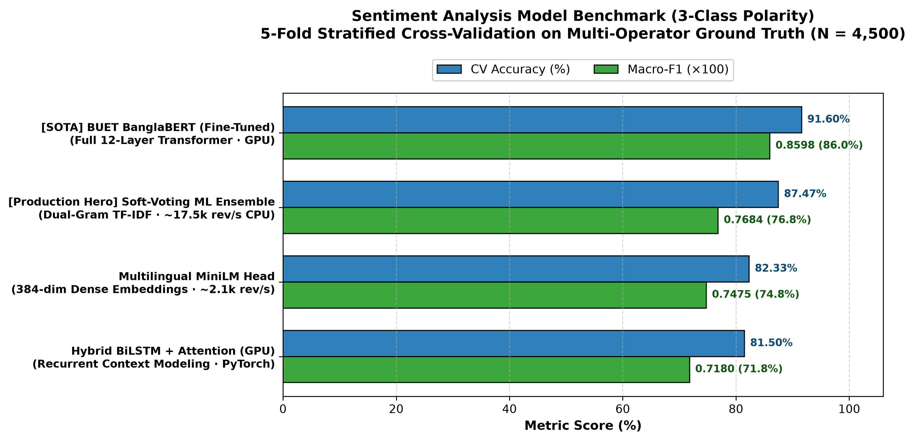
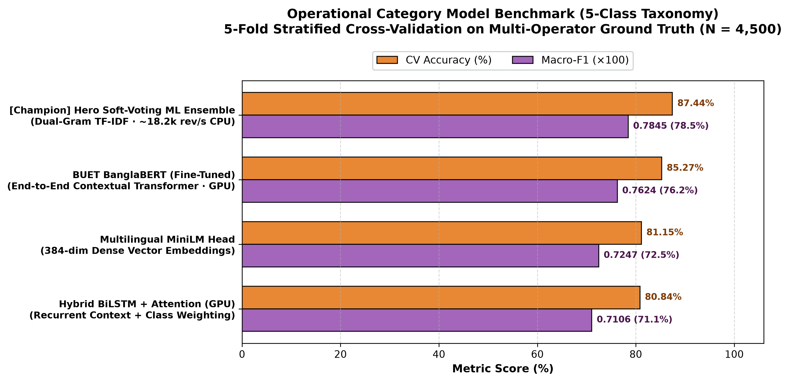

# 📡 Telecom VoC Deep Learning & Colab GPU Suites

This folder contains the complete Deep Learning pipeline, neural model architectures, and **GPU-accelerated Google Colab suites** for Bangladesh's telecommunications platforms:
* **Grameenphone Ltd.** (MyGP)
* **Robi Axiata Limited** (MyRobi)
* **Banglalink Digital Communications Limited** (MyBL)

---

### 🏆 1. Master Unified Colab Suite (All ML + DL Models in One File)

* [**`telecom_voc_master_unified_colab.ipynb`**](file:///home/ratul/Github/telecom-Voice-of-Customer_intelligence/dl/telecom_voc_master_unified_colab.ipynb): **Complete Unified Production Suite**. Trains, evaluates, and benchmarks **both Sentiment Analysis and Operational Comment Types** across Classical Soft-Voting Ensembles, Hybrid BiLSTM+Attention (PyTorch GPU), and Multilingual Sentence Transformers with automated 1-click model packaging.
  * **Direct Colab Link**:
    ```text
    https://colab.research.google.com/github/rh61632/telecom-Voice-of-Customer_intelligence/blob/main/dl/telecom_voc_master_unified_colab.ipynb
    ```

### Specialized Single-Task Notebooks
2. [**`telecom_voc_banglabert_finetuning_colab.ipynb`**](file:///home/ratul/Github/telecom-Voice-of-Customer_intelligence/dl/telecom_voc_banglabert_finetuning_colab.ipynb): 🇧🇩 **BUET BanglaBERT Full End-to-End Fine-Tuning** (`csebuetnlp/banglabert` 110M params). Performs 5-Fold Stratified CV and production model training with backpropagation through all 12 transformer layers.
   * **Direct Colab Link**:
     ```text
     https://colab.research.google.com/github/rh61632/telecom-Voice-of-Customer_intelligence/blob/main/dl/telecom_voc_banglabert_finetuning_colab.ipynb
     ```
3. [**`telecom_voc_deep_learning_colab.ipynb`**](file:///home/ratul/Github/telecom-Voice-of-Customer_intelligence/dl/telecom_voc_deep_learning_colab.ipynb): Focused **Sentiment Classification** (Positive, Neutral, Negative).
4. [**`archive/early_dl_experiments/telecom_voc_comment_type_classification_colab.ipynb`**](../archive/early_dl_experiments/telecom_voc_comment_type_classification_colab.ipynb): [Archived] Early exploratory frozen feature extractor notebook. Superseded by full fine-tuning notebook above.

---

### 💻 Local / CLI Training Scripts
* `dl/finetune_banglabert.py`: CLI for full fine-tuning of BanglaBERT (`--task both --epochs 4 --batch_size 32`).
* `dl/train_bilstm.py`: PyTorch BiLSTM + Attention training for Sentiment.
* `dl/train_bilstm_category.py`: PyTorch BiLSTM + Attention training for Operational Categories.
* `dl/train_transformer.py`: Pretrained Multilingual MiniLM sentence embeddings + classifier head.

---

## 🚀 How to Run in Google Colab (Free GPU)

1. Open the [Master Unified Colab Notebook](https://colab.research.google.com/github/rh61632/telecom-Voice-of-Customer_intelligence/blob/main/dl/telecom_voc_master_unified_colab.ipynb).
2. Enable GPU acceleration: **Runtime** ➔ **Change runtime type** ➔ **T4 GPU** ➔ **Save**.
3. Run all cells: **Runtime** ➔ **Run all** (or press `Ctrl + F9`).
4. When finished, Colab automatically compiles all trained weights into `telecom_voc_all_models_colab.zip` and triggers a browser download.

---

## 🧠 Model Architectures & GPU Benchmarks

Evaluated on the 4,500 curated ground-truth reviews across **Grameenphone**, **Robi**, and **Banglalink** using **5-Fold Stratified Cross-Validation**. Evaluated separately across the two distinct NLP tasks:

### 1. Sentiment Analysis Model Leaderboard (3-Class Polarity)
> Evaluated on 3-class sentiment polarity: **Positive**, **Neutral**, and **Negative**.

<div align="center">
  
</div>

| Rank | Model Architecture | CV Accuracy | Macro-F1 | Status / Implementation |
| :---: | :--- | :---: | :---: | :--- |
| 🥇 | **BUET BanglaBERT (Fine-Tuned)** | **91.60%** | **0.8598** | Full 12-layer backpropagation (`csebuetnlp/banglabert`) |
| 🥈 | **Hero Soft-Voting ML Ensemble** | **87.47%** | **0.7684** | Calibrated probability soft-voting classifier (~17.5k rev/s CPU) |
| 🥉 | **Multilingual MiniLM Head** | **82.33%** | **0.7475** | Multilingual sentence semantic representations (`paraphrase-multilingual-MiniLM-L12-v2`) |
| 4 | **Hybrid BiLSTM + Attention (GPU)** | **81.50%** | **0.7180** | Sequential context modeling with sub-word token embeddings |

---

### 2. Operational Category Model Leaderboard (5-Class Taxonomy)
> Evaluated on 5 operational complaint domains: **Offers & Data Packs**, **App Login & Technical Bugs**, **Network Speed & 4G Latency**, **Billing & Airtime Deductions**, and **General Appreciation / Other**.

<div align="center">
  
</div>

| Rank | Model Architecture | CV Accuracy | Macro-F1 | Status / Implementation |
| :---: | :--- | :---: | :---: | :--- |
| 🥇 | **Hero Soft-Voting ML Ensemble** | **87.44%** | **0.7845** | Dual-Gram TF-IDF + Logistic Regression + LinearSVC + ComplementNB |
| 🥈 | **BUET BanglaBERT (Fine-Tuned)** | **85.27%** | **0.7624** | Full 12-layer backpropagation (`csebuetnlp/banglabert`) |
| 🥉 | **Multilingual MiniLM Head** | **81.15%** | **0.7247** | `paraphrase-multilingual-MiniLM-L12-v2` 384-dim dense vectors |
| 4 | **Hybrid BiLSTM + Attention (GPU)** | **80.84%** | **0.7106** | PyTorch BiLSTM + Bahdanau Attention with class-weighted loss |

> [!NOTE]
> **Ablation Study (Frozen vs. Fine-Tuned)**: Evaluating BUET BanglaBERT as a static frozen feature extractor achieved 74.88% CV Accuracy / 0.6253 Macro-F1. End-to-end fine-tuning delivered a **+10.39% leap** to 85.27% CV Accuracy / 0.7624 Macro-F1, proving the necessity of fine-tuning for adapting to domain-specific Romanized Banglish. The original frozen head notebook is archived in [`archive/early_dl_experiments/`](../archive/early_dl_experiments/).

---

## 📂 Saved Artifacts in `dl/models/`

* `bilstm_sentiment_model.pt`: Trained PyTorch weights for Sentiment Analysis
* `bilstm_category_model.pt`: Trained PyTorch weights for Operational Comment Types
* `bilstm_vocab.joblib`: Serialized vocabulary dictionary
* `sent_le.joblib`: Sentiment label encoder
* `cat_le.joblib`: Operational category label encoder
* `minilm_sent_head.joblib`: Regularized MiniLM classification head (Sentiment)
* `minilm_cat_head.joblib`: Regularized MiniLM classification head (Category)
* `banglabert_finetuned_sentiment/`: Fine-tuned BUET BanglaBERT model for Sentiment (91.60% CV Acc)
* `banglabert_finetuned_category/`: Fine-tuned BUET BanglaBERT model for Operational Categories (85.27% CV Acc)
